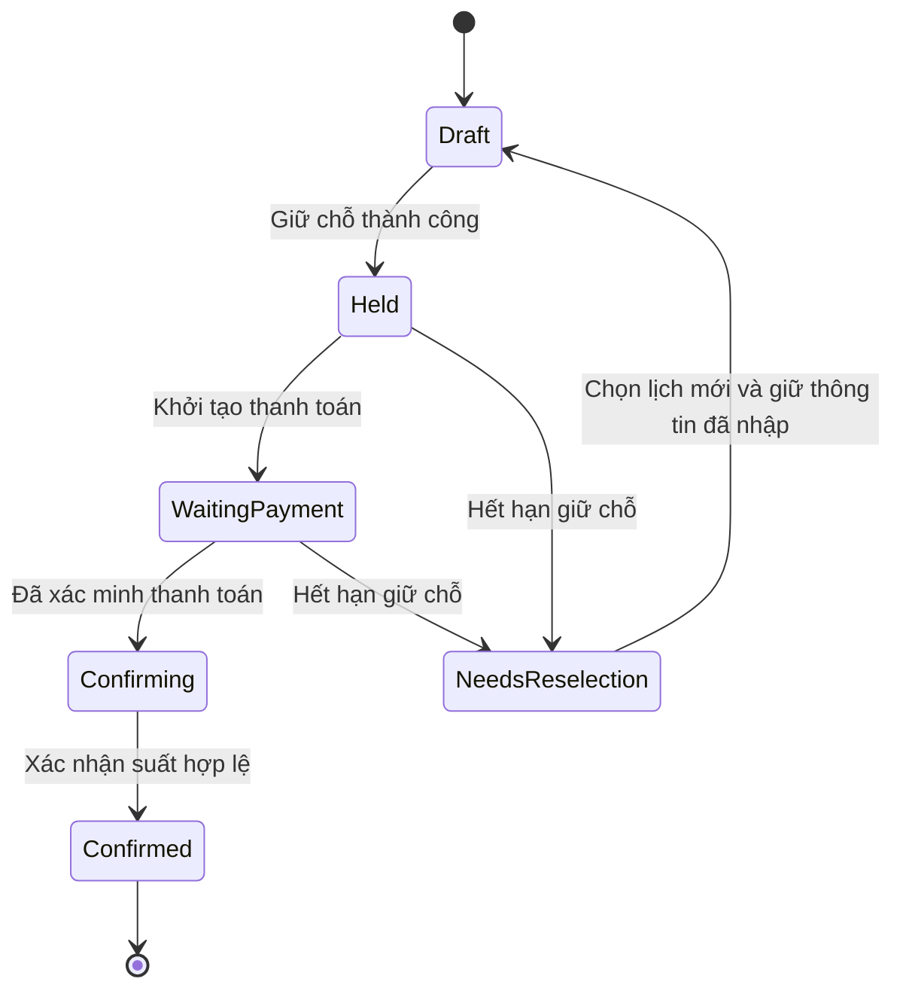
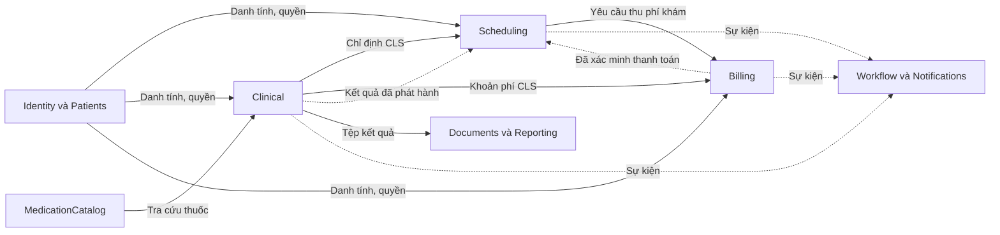
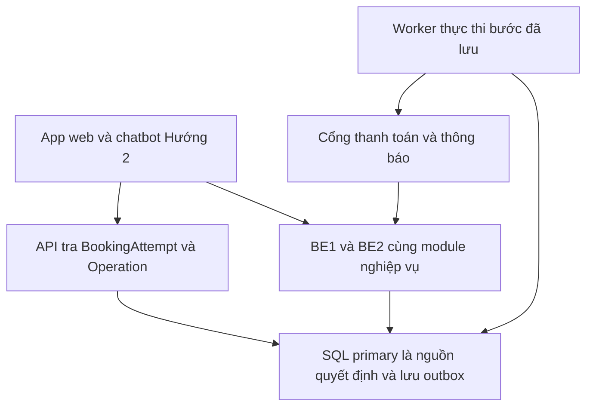

# Giải pháp kỹ thuật và xử lý sự cố Smart Healthcare

**Ngày cập nhật:** 29/10/2026  
**Phiên bản:** 2.1 bổ sung phân ngữ cảnh module, giao tiếp giữa module và cập nhật chatbot  
**Trạng thái:** Đã chốt kiến trúc và cơ chế bảo vệ đồng thời; cần triển khai, kiểm chứng và hoàn thiện tham số vận hành.

Tài liệu xác định cách triển khai các quy tắc trong Phạm vi nghiệp vụ Smart Healthcare, cơ chế bảo vệ dữ liệu, xử lý lỗi và khôi phục tiến trình. Kiến trúc triển khai là Modular Monolith cùng worker riêng, với mục tiêu tiến dần đến microservices theo ranh giới nghiệp vụ.

**Thay đổi trong phiên bản 2.1 (29/10/2026):**

| Nội dung | Từ phiên bản 2.0 | Thành phiên bản 2.1 |
| --- | --- | --- |
| Chatbot | FastAPI, LangGraph điều phối hội thoại, LangChain, Unified Model Adapter và máy chủ suy luận Ollama hoặc Transformers | FastAPI cùng LangChain `create_agent` và Ollama chạy model trong VPS; bỏ LangGraph tự dựng graph và bỏ Model Adapter |
| Phân ngữ cảnh module | Chỉ có bảng module và dữ liệu sở hữu | Bổ sung mục 8.1: tiêu chí xác định bounded context, ngôn ngữ nghiệp vụ từng ngữ cảnh, lý do chia và context map |
| Giao tiếp giữa module | Nêu nguyên tắc gọi contract và unit of work chung | Bổ sung mục 8.2: bốn phương thức giao tiếp, quy tắc chọn, cấu trúc project và ví dụ code |
| Sơ đồ kiến trúc | Ghi tên kèm mô tả chi tiết; R2 thuộc tầng Cloudflare | Sơ đồ chỉ ghi tên thành phần; R2 vẽ ở nhóm dịch vụ bên ngoài vì Backend gọi ra để lưu tệp |
| Đánh số mục 8 | 8.1 module, 8.2 đến 8.6 worker, outbox, triển khai, chatbot | 8.1 và 8.2 mới; các mục cũ 8.2 đến 8.6 chuyển thành 8.3 đến 8.7, nội dung giữ nguyên trừ phần chatbot |

Các quyết định áp dụng cho bản triển khai hiện tại:

| Nội dung | Cách làm đã chọn |
| --- | --- |
| Transaction | Dùng transaction ngắn cho đơn vị thay đổi nguyên tử trên SQL Server primary; không giữ transaction khi chờ người dùng, model hoặc dịch vụ ngoài |
| Khóa bi quan | Dùng khóa tại DB cho vùng tranh chấp suất, vòng đời reservation và nhận bệnh nhân/vị trí phục vụ; mọi replica cùng tuân thủ |
| Khóa lạc quan | Dùng rowversion cho dữ liệu chỉnh sửa từ màn hình hoặc tiến trình có thể cũ; phát hiện xung đột trước khi ghi |
| Idempotency | Lưu khóa thao tác, RequestHash và kết quả bền trong DB; phối hợp unique constraint để retry không nhân đôi tác dụng |
| Kiến trúc và worker | Hai replica .NET của cùng Modular Monolith; worker .NET riêng chạy Hangfire với SQL Server, Operation và Outbox |
| Hướng phát triển | Giữ ranh giới module và contract rõ từ đầu; tách service từng bước khi đã đáp ứng điều kiện dữ liệu, kiểm thử và vận hành |
| Giao tiếp giữa module | Gọi đồng bộ qua contract công khai; lệnh nguyên tử nhiều module qua application service và unit of work chung; việc sau commit qua integration event, Outbox và worker; không truy cập chéo DbContext hoặc bảng |
| Chatbot | Hướng 2 với FastAPI, LangChain `create_agent` và Ollama chạy model trong VPS; chỉ gọi API nghiệp vụ .NET |

Khóa lạc quan và khóa bi quan được dùng theo loại thao tác. Transaction và idempotency vẫn áp dụng cùng các cơ chế khóa để bảo vệ thay đổi liên quan và xử lý yêu cầu gửi lại. Model nền cụ thể cùng các tham số tải, retry và timeout cần tiếp tục được lựa chọn hoặc đo kiểm; quyết định về kiến trúc và cơ chế bảo vệ đồng thời đã chốt.

## 1 Transaction khóa bi quan khóa lạc quan và idempotency

Kết hợp transaction ngắn, khóa bi quan tại DB, khóa lạc quan bằng rowversion và idempotency. Transaction giữ thay đổi liên quan nguyên tử; khóa bi quan bảo vệ tài nguyên bị tranh chấp; khóa lạc quan phát hiện bản dữ liệu cũ; idempotency xử lý gửi lặp. Giữ chỗ và reservation là cùng một khái niệm nghiệp vụ, không xây hai tầng giữ chỗ độc lập.

| Cơ chế | Vấn đề xử lý | Cách dùng trong dự án |
| --- | --- | --- |
| Transaction ngắn | Cập nhật dở dang giữa các bản ghi | Bộ đếm, reservation, lịch hẹn, vé, bản ghi thao tác và outbox liên quan cùng thành công hoặc rollback trong phạm vi đã xác định |
| Khóa bi quan tại DB và cập nhật có điều kiện | Nhiều yêu cầu tranh cùng suất hoặc tài nguyên | Nhận khóa trên bản ghi bảo vệ tại primary rồi kiểm điều kiện hiện hành; quota, reservation và tài nguyên được cập nhật trong transaction ngắn |
| Khóa lạc quan bằng rowversion | Hai màn hình sửa cùng dữ liệu cũ | Lệnh sửa lịch, trạng thái vé hoặc kết quả phải gửi phiên bản đã đọc; báo xung đột nếu phiên bản đổi |
| Reservation có ExpiresAt | Người dùng mất thời gian thanh toán | Chiếm tạm một suất bằng bản ghi đã commit, có thời hạn và quy tắc hết hạn |
| Idempotency | Double click, retry, callback hoặc message lặp | Cùng thao tác hợp lệ được nhận diện lại và trả về cùng kết quả nghiệp vụ |
| Unique constraint | Trùng lịch, vé hoặc tác dụng do lỗi code | DB chặn các tổ hợp định danh không được trùng ngay cả khi đi qua hai Backend |
| Outbox và dữ liệu tiến trình bền | Commit xong nhưng chưa gửi việc hoặc chưa báo cho bên khác | Lưu việc cần làm cùng thay đổi DB; worker đọc lại sau restart |

Transaction bảo vệ một đơn vị thay đổi trong DB, không bao phủ thời gian người dùng nhập biểu mẫu, chờ model, thanh toán ngoài hệ thống hay thực hiện CLS. Rowversion là token phiên bản, không phải thời gian hết hạn, thứ tự ưu tiên hoặc khóa giữ suất. EF Core hỗ trợ kiểm token khi cập nhật và báo xung đột nếu dữ liệu đã đổi. [T1][T2]

### 1.1 Phân công khóa lạc quan và khóa bi quan

Áp dụng rowversion cho BookingAttempt, Appointment, Reservation, QueueTicket và Result khi có người hoặc worker cùng cập nhật. Nếu nhân viên vừa sửa kết quả, một màn hình cũ phải được báo thay đổi và tải lại. Không tự retry rồi ghi đè nội dung chuyên môn bằng bản nháp cũ.

Đối với điểm tranh suất, dùng hàng DoctorDayQuota đã tạo trước, duy nhất theo DoctorId và ServiceDate. Trong transaction ngắn, đọc hàng bảo vệ bằng `WITH (UPDLOCK, HOLDLOCK)` qua truy vấn có tham số và index phù hợp, kiểm giờ DB cùng điều kiện nhận suất rồi cập nhật có điều kiện. Các hint chỉ áp dụng cho truy vấn bảo vệ cần thiết; không cấu hình SERIALIZABLE cho toàn bộ hệ thống và không cam kết DB chỉ khóa đúng một hàng vật lý. [T13]

Khóa bi quan cũng bảo vệ tranh chấp xác nhận/hết hạn/hủy cùng reservation và nhận bệnh nhân/vị trí. Các đường ghi lấy cùng nhóm khóa theo thứ tự nhất quán; khi cùng tác động quota và reservation, khóa quota trước rồi reservation. Khi tác động nhiều quota hoặc nhiều vị trí, sắp theo định danh cố định trong từng nhóm. Khóa được giải phóng khi transaction kết thúc; thời gian người dùng thanh toán nằm ngoài khóa DB.

Rowversion kiểm bản dữ liệu mà người dùng hoặc worker đã đọc. Với lệnh giữ chỗ mới, số suất hiển thị chỉ tham khảo: Backend xét quota hiện hành dưới khóa, không từ chối chỉ vì phiên bản quota hiển thị đã cũ. Với lệnh sửa lịch, vé hoặc kết quả, phiên bản của đối tượng cần sửa phải được kiểm theo hợp đồng API.

| Thao tác | Cơ chế áp dụng |
| --- | --- |
| Tạo giữ chỗ | Transaction, khóa bi quan DoctorDayQuota, cập nhật quota có điều kiện, idempotency và unique claim |
| Xác nhận hoặc hết hạn giữ chỗ | Transaction, khóa quota rồi reservation, kiểm trạng thái và ExpiresAt, version phù hợp, chống callback/job lặp |
| Đổi hoặc hủy lịch | Transaction, khóa quota theo thứ tự cố định, kiểm rowversion lịch và reservation liên quan, idempotency |
| Nhận lượt khám hoặc CLS | Transaction, khóa bản ghi bảo vệ bệnh nhân và vị trí, kiểm trạng thái/version vé, unique phân bổ và idempotency |
| Chỉnh sửa hồ sơ hoặc kết quả | Transaction ngắn, rowversion và kiểm quyền; không giữ khóa DB trong thời gian nhân viên nhập biểu mẫu |

Tất cả các cơ chế trên được thực thi tại SQL Server primary, không phụ thuộc request vào BE1, BE2 hay worker.

Một câu SELECT đếm lịch rồi INSERT không có cơ chế bảo vệ không đủ an toàn, kể cả cùng nằm trong transaction ở mức cô lập mặc định. Một biến đếm, lock hoặc Semaphore trong RAM cũng không bảo vệ được hai replica Backend.

### 1.2 Hạt nhân của thao tác giữ chỗ

Trình tự minh họa dưới đây là thuật toán thiết kế, không phải mã SQL hoàn chỉnh.

```text
1. Xác thực quyền và chuẩn hóa yêu cầu; nhận OperationId ổn định.
2. Mở transaction; kiểm bản ghi idempotency và request hash.
3. Đọc hàng DoctorDayQuota của bác sĩ và ngày bằng UPDLOCK, HOLDLOCK trong transaction để nhận khóa bi quan.
4. Sau khi nhận khóa, đọc giờ UTC tại DB và kiểm lịch mở cùng CutoffAtUtc của ngày phục vụ.
5. Nếu HeldCount + AdmittedCount + LockedCancelledCount >= Capacity thì từ chối giữ chỗ.
6. Tăng HeldCount bằng cập nhật có điều kiện; kiểm số hàng bị ảnh hưởng.
7. Tạo Reservation Held có ExpiresAt và liên kết BookingAttempt.
8. Lưu kết quả Operation cùng outbox nếu có; commit rồi phản hồi.
```

Tạo trước hàng hạn mức khi mở lịch và đặt unique key DoctorId cùng ServiceDate. Mọi đường ghi phải cùng dùng quy tắc, gồm tại quầy, đổi lịch, callback và worker. Đọc giờ sau khi nhận khóa tránh trường hợp yêu cầu tới lúc 09:29 nhưng chờ khóa đến 09:31 vẫn dùng thời gian cũ để nhận suất.

Các thao tác cùng loại phải lấy khóa theo một thứ tự thống nhất; khi đổi giữa hai DoctorDay thì sắp xếp khóa theo khóa định danh cố định. Không gọi API thanh toán hoặc model trong transaction. Giới hạn thời gian giữ khóa bằng query có index phù hợp.

### 1.3 Hai người tranh suất cuối

Giả sử tổng suất bị chiếm là 29. Yêu cầu A và B cùng nhắm một bác sĩ và ngày; A nhận được một suất trước, tổng thành 30. B chỉ được đọc lại hoặc nhận kết quả hết chỗ, không được tạo reservation thứ 31. Giao diện B giữ hồ sơ đã nhập và gợi ý bác sĩ hoặc ngày khác. Nếu A hết hạn sau đó, suất chỉ được nhận lại bằng thao tác mới vẫn thỏa mốc tiếp nhận.

Không mặc định người bấm trước trên thiết bị được ưu tiên; thứ tự nhận thành công ở nguồn quyết định mới là căn cứ. Nếu muốn hàng chờ đăng ký có thứ tự công bằng toàn hệ thống, cần đặc tả riêng. Không dùng chính hàng đợi bệnh nhân CLS làm hàng đợi tranh suất.

## 2 Tiến trình đặt lịch phải được lưu như thế nào

### 2.1 Tách dữ liệu hội thoại và dữ liệu nghiệp vụ

Lịch sử chat, trường vừa nhập và câu hỏi đang chờ thuộc ngữ cảnh giao diện. BookingAttempt, Reservation, Appointment, PaymentIntent và Operation là dữ liệu nghiệp vụ cần lưu bền. Một checkpoint của chatbot có thể khôi phục câu chuyện nhưng không được dùng làm bằng chứng đã có suất hoặc đã trả tiền.

Backend cấp hoặc nhận một BookingAttemptId ổn định ngay khi bắt đầu thao tác. Lưu các trường đã được xác nhận theo từng bước với version, gồm hồ sơ bệnh nhân, bác sĩ, ngày, lựa chọn lịch, reservation và thanh toán liên quan. Frontend giữ mã tham chiếu để mở lại; sau đăng nhập, người dùng cũng có thể lấy các tiến trình còn tiếp tục được qua API thuộc quyền của họ.

Nháp được lưu trên server sau mỗi bước hợp lệ. Phần người dùng gõ nhưng chưa gửi chỉ có thể khôi phục nếu ứng dụng đã lưu nháp phù hợp; không cam kết giữ được dữ liệu chưa từng được lưu. Không ghi thông tin thẻ hoặc bí mật thanh toán vào bản nháp hay log.

### 2.2 Các nhóm trạng thái độc lập

| Đối tượng | Ví dụ trạng thái | Ý nghĩa |
| --- | --- | --- |
| BookingAttempt | Draft, AwaitingConfirmation, Held, WaitingPayment, Confirming, Confirmed, NeedsReselection | Người dùng đang ở bước nào của tiến trình đặt lịch |
| Reservation | Held, Confirmed, Expired, Cancelled | Suất có còn được giữ hay đã chuyển thành lịch xác nhận |
| PaymentIntent | Pending, Paid, Failed, Unknown, RefundPending, Refunded | Sự thật về thanh toán và việc xử lý khoản tiền |
| Operation | Pending, Running, WaitingExternal, RetryScheduled, Succeeded, NeedsAction, ManualReview | Một lệnh đã nhận đang xử lý đến đâu |
| Lượt phục vụ và kết quả | Waiting, Called, InProgress, ServiceFinished; kết quả Draft hoặc Published | Tình trạng phục vụ trực tiếp khác tình trạng có kết quả |

Các trạng thái là tên gợi ý để nhóm thống nhất khi thiết kế schema. Không ép tất cả vào một cột Status rồi cho phép tùy ý đổi từ đang khám thành đã thanh toán. Mỗi chuyển trạng thái cần ghi điều kiện, quyền, version và tác dụng lên tài nguyên.



Sơ đồ mô tả tiến trình đặt lịch; lỗi kỹ thuật và trạng thái khoản tiền được theo dõi riêng. Timeout không tự chuyển lịch đã xác nhận về Draft. Nếu đã nhận tiền nhưng giữ chỗ không còn hợp lệ, chuyển sang quy trình xử lý PaidUnallocated thay vì báo đặt thành công.

### 2.3 API và hành vi khôi phục

Triển khai API tạo hoặc lưu BookingAttempt; API giữ chỗ; API yêu cầu thanh toán; API đọc trạng thái tiến trình và Operation; API tiếp tục, đổi hoặc hủy theo các hành động hợp lệ. Mỗi API thay đổi nhận Idempotency Key cùng phiên bản khi cần, và kiểm quyền tại server.

Khi mở lại ứng dụng, Backend trả trạng thái hiện hành, các bước đã hoàn tất, ExpiresAt và AllowedActions. Nếu còn reservation hợp lệ thì người dùng tiếp tục thanh toán; nếu đã có vé thì hiển thị vé; nếu đang xác minh khoản tiền thì hiển thị chờ xác minh; nếu hết suất giữ thì giữ hồ sơ nhưng yêu cầu chọn lại lịch. Tiếp tục quy trình không đồng nghĩa giữ chỗ vô thời hạn hoặc miễn xác thực lại khi phiên đăng nhập hết hạn.

Với bước xử lý dài đã được lưu bền, API có thể trả 202 Accepted kèm OperationId và đường kiểm tra trạng thái. Chỉ trả đã tiếp nhận khi bản ghi và việc cần xử lý đã commit. Nếu chính lần tạo tiến trình bị mất phản hồi, tra lại bằng mã yêu cầu ổn định hoặc danh sách tiến trình thuộc người dùng; không tạo mã mới rồi đặt thêm lần nữa.

## 3 Phân biệt timeout deadlock và xung đột phiên bản

### 3.1 Deadlock đã được SQL Server báo lỗi 1205

Khi một transaction bị chọn làm nạn nhân deadlock, SQL Server rollback transaction đó và trả lỗi 1205. Ứng dụng có thể thử lại **toàn bộ transaction ngắn** từ dữ liệu mới sau một khoảng chờ ngắn. Không chỉ chạy lại câu lệnh cuối vì các thay đổi trước đó trong transaction cũng đã bị rollback. [T3]

Đề xuất retry tối đa ba lần thử lại với backoff và jitter trong ngân sách thời gian của request; các con số phải được hiệu chỉnh bằng thử nghiệm. Dùng cùng mã thao tác, kiểm lại quyền, thời gian, suất và trạng thái. Nếu đã qua mốc đóng hoặc hết chỗ thì trả kết quả nghiệp vụ tương ứng; không bỏ kiểm tra chỉ vì lần đầu đã thử trước 09:30.

Retry hết giới hạn thì giữ nháp và trả trạng thái có thể thử lại hoặc xử lý nền nếu lệnh đã được tiếp nhận bền. Theo dõi deadlock graph, thứ tự lấy khóa, index và transaction dài để sửa nguyên nhân. Worker cũng có thể gặp deadlock; chuyển công việc sang worker không tự loại bỏ nó.

### 3.2 Timeout HTTP hoặc đứt mạng khi commit

Người dùng thấy timeout không chứng minh thao tác thất bại. Backend có thể đã commit, còn phản hồi bị mất. Đứt kết nối đúng lúc commit có thể khiến bên gọi chưa biết transaction đã thành công hay chưa. EF Core có hướng dẫn kiểm chứng kết quả commit và lưu định danh thao tác để xử lý tình huống này. [T4]

Giao diện hiển thị đang kiểm tra kết quả; gọi API tra OperationId hoặc BookingAttemptId trên nguồn hiện hành. Nếu đã thành công thì trả vé cũ; nếu đang xử lý thì tiếp tục theo dõi; nếu chưa được tiếp nhận thì gửi lại cùng idempotency key. Không tự tạo reservation mới, số vé mới hoặc yêu cầu thanh toán mới chỉ vì không nhận được HTTP 200.

### 3.3 Lock timeout hoặc command timeout ở DB

Lock timeout là chờ khóa quá thời hạn, khác deadlock. SET LOCK_TIMEOUT cấu hình thời gian một câu lệnh chờ khóa. [T5] Ứng dụng không được suy diễn rằng mọi loại timeout đều đã rollback toàn bộ transaction. Cần kết thúc transaction lỗi rõ ràng bằng rollback hoặc hủy và giải phóng context, rồi dùng kết nối mới để kiểm tra kết quả khi tình trạng commit chưa rõ.

Không giữ lại transaction cũ để chờ người dùng bấm tiếp. Retry phải có giới hạn và chạy lại đơn vị công việc đã thiết kế. Không áp dụng retry cho lỗi quyền, dữ liệu sai, hết suất hoặc đã quá mốc tiếp nhận.

### 3.4 Xung đột rowversion

Đây là tín hiệu có thay đổi đồng thời, không đồng nghĩa hệ thống sập. Với trạng thái đơn giản có thể đọc lại và xét lệnh từ đầu; với nội dung kết quả hoặc chẩn đoán phải hiển thị bản hiện hành cùng bản nháp để người có quyền quyết định. Không tự dùng chiến lược ghi đè sau cùng cho dữ liệu chuyên môn.

Nếu dùng EF Core execution strategy cùng transaction tự mở, phải để execution strategy thực thi lại trọn đơn vị transaction, không lồng retry rải rác ở từng repository. Việc gọi hệ thống ngoài vẫn phải có định danh và cơ chế kiểm kết quả riêng. [T4]

## 4 Idempotency phải gắn với nghiệp vụ

Mỗi thao tác thay đổi có khóa ổn định trong phạm vi người gọi và loại thao tác, ví dụ tạo giữ chỗ cho một BookingAttempt. Backend lưu RequestHash của nội dung chuẩn hóa cùng OperationId, trạng thái và kết quả. Có unique constraint trên tổ hợp phạm vi và khóa.

- Cùng khóa và cùng nội dung trả lại kết quả đã có hoặc thông tin thao tác đang chạy.
- Cùng khóa nhưng khác nội dung bị từ chối và yêu cầu sửa cách gọi, không được trả vé của một nội dung khác.
- Hai Backend nhận cùng khóa phải tranh tại DB; bản ghi đang chạy không được coi ngay là thành công.
- Callback dùng định danh giao dịch hoặc sự kiện do cổng thanh toán cung cấp; consumer message dùng MessageId đã xử lý.
- Người dùng cố tình chọn lịch khác là thao tác mới, cần xác nhận mới và kiểm lại quyền; không tái dùng bằng chứng đồng ý của đề nghị cũ.

Trong lệnh đồng bộ, bản ghi kết quả idempotency phải commit cùng tác dụng nghiệp vụ. Trong lệnh bất đồng bộ, bước tiếp nhận lưu Operation Pending cùng việc cần xử lý; worker hoàn tất bằng transaction có điều kiện. Không chỉ lưu khóa trong RAM hoặc Redis rồi để DB tự tạo vé độc lập.

Chặn trùng người bệnh cùng bác sĩ và ngày bằng một claim đang hoạt động trong dữ liệu reservation. Claim vẫn hoạt động khi đã chuyển sang lịch xác nhận và chỉ được kết thúc theo chính sách, giúp hai kênh dùng hai idempotency key khác nhau vẫn không tạo hai lịch trùng. Unique key cho Appointment theo reservation, vé theo nguồn tạo, và giao dịch theo mã nhà cung cấp bổ sung lớp bảo vệ ở DB. Thời gian giữ dữ liệu chống lặp phải bao phủ cửa sổ retry và đối soát, không xóa trước khi còn khả năng nhận callback cũ.

## 5 Giữ chỗ hết hạn và thanh toán chưa rõ kết quả

### 5.1 Thời hạn giữ chỗ

HoldDuration mặc định đã chốt là 5 phút. Reservation có ExpiresAt do server xác định bằng thời điểm chấp nhận giữ chỗ cộng HoldDuration; không giới hạn bằng CutoffAt. Giữ chỗ nhận trước 09:30 vẫn được thanh toán và xác nhận sau 09:30 nếu chưa hết hạn, nhưng không được tạo mới hoặc gia hạn sau mốc đóng của ngày D. Đồng hồ đếm ngược trên app chỉ để hiển thị. Backend kiểm thời hạn ở mọi lệnh xác nhận, kể cả khi worker dọn hết hạn chưa chạy. Liên kết thanh toán cần có thời hạn tương thích; không gia hạn tùy ý mỗi lần refresh.

Callback xác nhận và worker hết hạn cùng kiểm trạng thái Held, ExpiresAt và version trong transaction, theo thứ tự khóa thống nhất. Nếu xác nhận thắng hợp lệ, worker không được trừ lại HeldCount. Nếu hết hạn thắng, callback không được tạo lịch từ reservation đã mất. Chuyển trạng thái và điều chỉnh bộ đếm chỉ xảy ra một lần.

### 5.2 Đã nhận tiền nhưng không còn suất

Khi giữ chỗ hết hạn, trả suất theo thời hạn cứng bằng chuyển trạng thái có điều kiện trong transaction. Khoản thanh toán chưa xác định tiếp tục được theo dõi bằng PaymentIntent riêng. Không giữ suất vô hạn chỉ vì hệ thống ngoài chưa trả lời, và cũng không coi khoản tiền là thất bại để yêu cầu bệnh nhân trả lại ngay.

Nếu sau đó cổng thanh toán xác minh đã thu tiền, lưu trạng thái khoản tiền Paid và trường hợp PaidUnallocated trong tiến trình đặt lịch. Không cấp quá 30 và không tự lấy chỗ của bệnh nhân khác. Hiển thị đã nhận tiền nhưng chưa xác nhận lịch, rồi thực hiện hoàn tiền hoặc hỗ trợ đổi phương án theo quy trình được phê duyệt. Không tự động nhận suất mới sau 09:30. Một khoản hoàn tiền là nghiệp vụ riêng có idempotency và có thể cần xử lý thủ công; rollback SQL không hoàn tác được khoản đã thu ở cổng ngoài.

### 5.3 Vai trò của đối soát nền

Worker truy vấn trạng thái thanh toán theo định danh đã có khi callback thất lạc, kiểm sự kiện đến muộn, phát hiện Paid chưa gắn lịch hoặc hoàn tiền còn treo và đưa ngoại lệ lên màn hình xử lý. Transaction chỉ bảo vệ dữ liệu nằm trong phạm vi transaction; nó không buộc hệ thống thanh toán bên ngoài cùng commit hoặc rollback. Đây là lý do cần đối soát ngay cả khi SQL Server đã bảo đảm ACID.

Chỉ tin xác minh server với thông tin giao dịch, số tiền, người nhận và mã tham chiếu phù hợp. Trang trình duyệt quay về báo thành công không phải nguồn xác nhận thanh toán. Sự kiện cũ Pending hoặc Failed không được ghi đè một trạng thái Paid đã được xác minh; hoàn tiền phải đi qua chuyển trạng thái riêng.

## 6 Xử lý timeout trong hành trình khám và CLS

### 6.1 Một bệnh nhân được gọi ở hai phòng

Scheduling sở hữu PatientEngagement chung theo PatientId cho mọi vé đang hoạt động của bệnh nhân. Chuẩn bị bản ghi bảo vệ bệnh nhân trước khi vào luồng nhận lượt. Trong transaction ngắn, nhận khóa bi quan trên bản ghi bảo vệ bệnh nhân rồi ServiceStation theo thứ tự thống nhất, kiểm điều kiện hiện hành và version vé, sau đó nhận vé cùng phân bổ tài nguyên. Kết hợp unique constraint và cập nhật có điều kiện để một bệnh nhân hoặc vị trí chỉ có một phân bổ hoạt động. Mỗi lệnh nhận lượt có idempotency. Rowversion của hai vé riêng lẻ không đủ vì hai phòng có thể sửa hai hàng khác nhau.

Chỉ tạm hoãn vì bệnh nhân thực sự đang được nhận hoặc phục vụ ở điểm khác. Không phạt thứ tự vì dữ liệu cache cũ. Số vé gốc giữ nguyên; khi rảnh thì xét lại theo chính sách công bằng và tình trạng hiện hành trên primary.

### 6.2 Timeout khi gọi hoặc đã bắt đầu phục vụ

Một lượt Called có thể có hạn phản hồi và thao tác xác nhận có mặt. Khi quá hạn, worker chuyển sang cần xác minh hoặc vắng mặt theo chính sách; không tự coi đã khám xong. Nếu cấu hình tự thu hồi quyền gọi chưa bắt đầu, phải dùng lease token tăng dần và kiểm token ở lệnh bắt đầu; thiết bị cũ không được tiếp tục bằng token đã bị thu hồi.

Khi đã InProgress, việc mất mạng hoặc mất heartbeat chỉ tạo cảnh báo. Không tự giải phóng bệnh nhân và máy vì đã quá một số phút, vì thực tế có thể vẫn đang chụp hoặc làm thủ thuật. Nhân viên phải xác nhận tiếp tục, kết thúc hoặc điều chỉnh qua thao tác có lý do và audit. Đề xuất timeout ở giai đoạn này là ngưỡng phát hiện bất thường, không phải kết luận chuyên môn.

### 6.3 Bệnh nhân rảnh nhưng kết quả vẫn đang xử lý

Khi nhân viên xác nhận kết thúc thao tác trực tiếp, Scheduling giải phóng patient engagement và vị trí trên nguồn có thẩm quyền. Bệnh nhân có thể sang điểm khác; Result vẫn Pending hoặc Draft ở Clinical. Chỉ ResultPublished của các dịch vụ bắt buộc mới thỏa điều kiện quay lại.

Nếu nguồn quyết định chưa xác nhận giải phóng, hiển thị thao tác chưa xác nhận và tiếp tục bằng cùng OperationId. Không dựa vào thông báo SignalR đã gửi hoặc một projection cũ để kết luận đã rảnh. Khi tách service sau này, lệnh giải phóng vẫn phải đến Scheduling, không chỉ phát một sự kiện rồi mặc định đã xong.

### 6.4 Tệp kết quả lỗi hoặc bác sĩ không thể tiếp tục phiên

Upload lỗi thì giữ metadata nháp và cho gửi lại đúng ResultId, không tạo chỉ định hoặc vé mới. Chỉ phát hành khi tệp tồn tại, liên kết đúng bệnh nhân và kết quả đã được duyệt theo quyền. Đối soát tệp mồ côi hoặc metadata thiếu tệp là tác vụ nền.

Kết quả trả vào buổi chiều không phải lý do đóng phiên: bác sĩ ban đầu tiếp tục đọc kết quả và kết luận vì không có giờ đóng ca cứng. Nếu bác sĩ thực sự không thể tiếp tục phiên do ngoại lệ, chuyển danh sách chờ xử lý sang nhân viên điều phối. Giữ bác sĩ và phòng ban đầu làm thông tin gốc; việc hẹn tiếp hoặc chuyển người đọc kết quả phải được ghi nhận rõ. Không tự kết thúc Encounter, tự thay bác sĩ hoặc tự mở một lượt khám có phí mới.

## 7 Ma trận tình huống lỗi và cách phục hồi

| Tình huống | Xử lý tại Backend hoặc worker | Trải nghiệm tiếp tục |
| --- | --- | --- |
| Online và tại quầy tranh suất cuối | Cùng cập nhật hạn mức có điều kiện trên primary | Một người có giữ chỗ, người còn lại giữ thông tin đã nhập để chọn phương án khác |
| Double click hoặc hai request cùng khóa | Unique idempotency và tra kết quả Operation | Không thêm vé, không yêu cầu thanh toán lại |
| Cùng người dùng đặt qua hai kênh với khóa khác nhau | Chặn trùng claim hoạt động theo bệnh nhân, bác sĩ và ngày | Mở lịch hoặc tiến trình đang có |
| Deadlock 1205 | Retry trọn transaction có giới hạn sau rollback | Giữ nháp; nếu chỗ đã mất thì chọn lại lịch |
| HTTP timeout sau khi đã commit | Tra OperationId và bản ghi nghiệp vụ | Hiển thị vé đã tạo hoặc tiến trình đang xử lý |
| Không rõ request đã đến server hay chưa | Tra bằng mã ổn định rồi gửi lại cùng khóa khi thích hợp | Tiếp tục cùng tiến trình |
| Giữ chỗ hết hạn khi đang thanh toán | Hết hạn có điều kiện, xử lý tiền riêng khi biết kết quả | Giữ hồ sơ; báo rõ chưa có lịch xác nhận |
| Callback thanh toán lặp hoặc sai thứ tự | Xác minh, chống lặp và kiểm chuyển trạng thái | Không thu hoặc cấp vé hai lần |
| Worker chết giữa công việc | Lease hết hạn cho phép worker khác tiếp nhận, kiểm fencing token và idempotency | Vẫn thấy cùng Operation, có thể cập nhật chậm |
| DB đã commit nhưng broker hoặc SignalR lỗi | Outbox giữ việc; gửi lại sau | Tra cứu API vẫn thấy trạng thái thật |
| Hai thiết bị cùng tài khoản phòng cập nhật một vé | Kiểm version và lệnh hợp lệ | Thiết bị thua tải trạng thái mới, giữ nháp cần thiết |
| Hai phòng gọi cùng bệnh nhân | PatientEngagement và nhận tài nguyên nguyên tử | Phòng chưa nhận được gọi người khác hoặc tải lại |
| Quá hạn Called nhưng chưa xác nhận bắt đầu | Thu hồi hoặc chờ nhân viên theo chính sách, chặn token cũ | Không đánh dấu đã hoàn tất dịch vụ |
| Mất mạng trong InProgress | Cảnh báo và xác minh bởi nhân viên | Không tự giải phóng người hoặc máy |
| Đã lấy mẫu nhưng chưa có kết quả | Giải phóng phục vụ trực tiếp, giữ trạng thái chờ kết quả riêng | Bệnh nhân tiếp tục dịch vụ khác |
| Đổi lịch gặp hết chỗ hoặc lỗi | Giữ lịch cũ đến khi chuyển mới thành công | Không mất lịch cũ vì đã bấm đổi |
| Model hoặc chatbot lỗi | Không thay đổi DB nếu chưa có lệnh hợp lệ | Tiếp tục bằng biểu mẫu, cùng BookingAttempt nếu đã có |

## 8 Kiến trúc Modular Monolith cùng worker

Giữ nền công nghệ đã chọn trong báo cáo tuần 1; lần điều chỉnh này thu hẹp nghiệp vụ và bổ sung tính bền của tiến trình, không đổi toàn bộ stack.

| Thành phần | Định hướng sử dụng |
| --- | --- |
| Backend và dữ liệu | Hai replica BE1 và BE2 của ASP.NET Core .NET, EF Core, cùng dùng SQL Server primary cho mọi quyết định nghiệp vụ quan trọng |
| Giao diện | React và React Hook Form cho web; React Native cùng Expo cho app bệnh nhân |
| Chatbot | Hướng 2 đã chọn: model do nhóm fine-tune, phục vụ bằng Ollama trong VPS; FastAPI quản lý API và ngữ cảnh, LangChain `create_agent` khai báo công cụ, gọi model và giữ lịch sử hội thoại; không tự dựng graph LangGraph, không dùng Model Adapter |
| Công việc nền | Worker .NET riêng chạy Hangfire với SQL Server; Operation và Outbox giữ tiến trình nghiệp vụ, áp dụng cùng quy tắc bảo vệ dữ liệu như API |
| Tệp kết quả | Cloudflare R2 private cùng metadata và kiểm quyền tại Backend; không lấy bài học MinIO làm quyết định đổi kho lưu |
| Triển khai | Docker Compose, Nginx, VPS Ubuntu, Cloudflare và Zero Trust; Jenkins theo lộ trình triển khai |

### 8.1 Phân ngữ cảnh nghiệp vụ và lý do chia module

Mỗi module là một **bounded context**: một vùng nghiệp vụ có ngôn ngữ riêng, dữ liệu riêng và bộ quy tắc bất biến do chính nó bảo vệ. Ranh giới được xác định từ workflow khám trong tài liệu phạm vi, không chia theo màn hình, theo vai trò người dùng hay theo bảng dữ liệu.

#### 8.1.1 Quy trình xác định ranh giới

1. **Liệt kê sự kiện nghiệp vụ theo workflow** (event storming rút gọn): Đã giữ chỗ, Đã xác nhận lịch, Đã check in, Đã gọi khám, Đã chỉ định CLS, Đã thanh toán, Đã kết thúc thao tác, Đã phát hành kết quả, Đã kê đơn, Đã hủy lịch, Đã hoàn tiền.
2. **Gom các sự kiện cùng bảo vệ một bất biến.** Dữ liệu nào bắt buộc phải đúng cùng lúc trong một transaction thì nằm chung một ngữ cảnh.
3. **Kiểm tra ngôn ngữ.** Khi một thuật ngữ đổi nghĩa giữa hai nhóm sự kiện, đó là dấu hiệu có ranh giới.
4. **Đối chiếu thêm các tiêu chí phụ:** người dùng và quyền, phụ thuộc hệ thống ngoài, nhịp thay đổi và kiểu truy cập dữ liệu.

| Tiêu chí | Câu hỏi kiểm tra | Ví dụ áp dụng trong dự án |
| --- | --- | --- |
| Bất biến nhất quán | Những dữ liệu nào phải đúng cùng lúc, trong cùng transaction và cùng khóa? | Tối đa 30 suất, mốc 09:30, mốc 05:00 và một bệnh nhân chỉ được gọi ở một nơi cùng dùng quota, reservation, vé và PatientEngagement, nên gom vào Scheduling |
| Ngôn ngữ nghiệp vụ | Thuật ngữ có đổi nghĩa khi sang nhóm nghiệp vụ khác không? | "Hoàn tất" ở phòng CLS là ServiceFinished, ở chuyên môn là ResultPublished, ở thanh toán là Paid; ba nghĩa thuộc ba ngữ cảnh |
| Người dùng và quyền | Ai được thay đổi dữ liệu và theo quyền gì? | Chẩn đoán, kết quả và đơn thuốc chỉ do bác sĩ hoặc người duyệt thay đổi, có phiên bản và audit, nên tách thành Clinical |
| Phụ thuộc hệ thống ngoài | Nghiệp vụ có phải chờ, xác minh hoặc đối soát với bên ngoài không? | Thanh toán phụ thuộc VNPT/MoMo, xử lý bất đồng bộ và phải đối soát, nên tách thành Billing |
| Nhịp thay đổi và kiểu truy cập | Dữ liệu đọc nhiều hay ghi nhiều, đổi thường xuyên hay hiếm? | Danh mục thuốc đọc nhiều, cập nhật hiếm, cần Full-Text Search, nên tách thành MedicationCatalog |

#### 8.1.2 Một thuật ngữ mang nghĩa khác nhau ở từng ngữ cảnh

| Thuật ngữ | Identity và Patients | Scheduling | Clinical | Billing |
| --- | --- | --- | --- | --- |
| Bệnh nhân | Tài khoản, hồ sơ, quan hệ người đại diện | Người giữ claim suất, đang bận ở một điểm phục vụ hay không | Đối tượng của lượt khám, tiền sử, sinh hiệu | Người phải trả và người nhận hoàn |
| Bác sĩ | Danh tính và vai trò | Lịch, phiên, DoctorDayQuota, phòng ban đầu | Người khám, chẩn đoán, kết luận, kê đơn | Cấp bậc làm căn cứ áp giá phí khám |
| Lượt khám | Không dùng | Lịch hẹn và các vé trong hành trình | Encounter chứa toàn bộ nội dung chuyên môn | Các khoản phí và giao dịch gắn với lượt |
| Hủy | Không dùng | Trả suất hoặc khóa suất theo mốc 05:00 | Hủy hoặc miễn một dịch vụ đã chỉ định | Có phát sinh hoàn tiền hay không |
| Hoàn tất | Không dùng | Kết thúc thao tác trực tiếp, giải phóng bệnh nhân | Kết quả đã phát hành, bác sĩ đã kết luận | Giao dịch đã xác minh thành công |

Nếu gom tất cả vào một model chung, một entity Patient hoặc một cột Status phải gánh mọi nghĩa trên. Khi đó mỗi lần sửa quy tắc thanh toán đều có nguy cơ ảnh hưởng tới quy tắc cấp suất. Tách theo ngữ cảnh cho phép mỗi module giữ model nhỏ, chỉ chứa các thuộc tính phục vụ quy tắc của nó.

#### 8.1.3 Các ngữ cảnh và lý do chia

| Module | Loại miền | Bất biến do module bảo vệ | Lý do tách thành ngữ cảnh riêng |
| --- | --- | --- | --- |
| Scheduling | Miền lõi | Tối đa 30 suất, BookingCutoff 09:30, RescheduleCutoff 05:00, giữ chỗ 5 phút, một bệnh nhân một điểm phục vụ, vé quay lại đúng bác sĩ ban đầu | Mọi quy tắc tranh chấp tài nguyên dùng chung quota, reservation, vé và PatientEngagement, cần chung transaction và khóa bi quan. Tách nhỏ hơn sẽ buộc phải dùng transaction phân tán |
| Clinical | Miền lõi | Encounter, kết quả Draft đến Published, chỉ bác sĩ ban đầu kết luận, sửa nội dung đã phát hành phải giữ phiên bản | Dữ liệu y tế nhạy cảm, quyền chuyên môn riêng, vòng đời dài hơn vé (lưu lâu dài làm lịch sử khám) |
| Billing | Miền hỗ trợ | Giá đã áp dụng không đổi theo bảng giá mới, chỉ ghi Paid sau khi xác minh, hoàn tiền đúng một lần | Phụ thuộc cổng thanh toán, xử lý bất đồng bộ và đối soát; là ứng viên tách service đầu tiên theo mục 9 |
| Identity và Patients | Miền chung | Danh tính, quyền, RoomAccount gắn RoomId, quan hệ người đại diện | Mọi module đều cần nhưng không module nào được tự định nghĩa quyền |
| MedicationCatalog | Miền hỗ trợ | Danh mục thuốc, hoạt chất, thành phần; không có kho | Đọc nhiều, cập nhật hiếm, dùng Full-Text Search; Clinical lưu bản chụp tên và hàm lượng khi kê đơn nên danh mục đổi không làm sai đơn cũ |
| Workflow và Notifications | Miền chung | Theo dõi Operation, phát Outbox, gửi push và SignalR | Hạ tầng điều phối, không sở hữu dữ liệu nghiệp vụ, tránh để module nghiệp vụ tự gọi dịch vụ ngoài |
| Documents và Reporting | Miền chung | Metadata tệp, quyền tải, chỉ trả tệp sau khi Published; báo cáo chỉ đọc | Gắn với kho R2 và truy vấn tổng hợp, tách khỏi quy tắc chuyên môn của kết quả |

**Các cách chia đã cân nhắc và không chọn:**

- **Tách hàng đợi CLS khỏi Scheduling:** không chọn, vì quy tắc "một bệnh nhân không bị gọi ở hai nơi" và quota cùng dựa trên vé và PatientEngagement. Tách ra thì một lệnh gọi lượt phải đi qua hai transaction.
- **Chia theo vai trò** (module tiếp tân, module bác sĩ, module phòng CLS): không chọn, vì vai trò là quyền chứ không phải ranh giới dữ liệu. Cùng một vé được tiếp tân, điều dưỡng và phòng CLS lần lượt cập nhật.
- **Mỗi phòng CLS một module hoặc service:** không chọn, vì các phòng cùng quy tắc, chỉ khác RoomId và cấu hình.
- **Gộp Billing vào Scheduling:** không chọn, vì thời gian chờ cổng thanh toán không được nằm trong transaction giữ suất. Hai bên chỉ gặp nhau qua sự kiện "đã xác minh thanh toán".
- **Gộp MedicationCatalog vào Clinical:** không chọn, vì tra cứu thuốc có kiểu truy cập và nhịp cập nhật khác hẳn hồ sơ khám.

**Ranh giới Appointment và Encounter:** Appointment thuộc Scheduling vì đó là cam kết về suất. Encounter thuộc Clinical vì đó là hồ sơ chuyên môn. Đề xuất Clinical mở Encounter khi vé được check in, rồi phát sự kiện để Billing gắn khoản phí khám đã thu lúc đặt lịch vào đúng EncounterId; thời điểm mở Encounter cần nhóm chốt khi thiết kế schema.

#### 8.1.4 Context map



Nét liền là lời gọi đồng bộ qua contract; nét đứt là integration event đi qua Outbox. Chiều mũi tên là chiều phụ thuộc: module ở gốc là thượng nguồn và cung cấp contract hoặc sự kiện; module ở đầu mũi tên dùng lại.

| Quan hệ | Kiểu quan hệ | Cách giữ ranh giới |
| --- | --- | --- |
| Identity và Patients với mọi module | Thượng nguồn cung cấp dịch vụ mở | Các module chỉ dùng UserId, PatientId, vai trò và RoomId từ contract; không đọc bảng tài khoản |
| Scheduling với Billing | Khách hàng và nhà cung cấp hai chiều | Scheduling yêu cầu tạo khoản thu qua contract; Billing báo kết quả bằng sự kiện; Scheduling vẫn tự kiểm ExpiresAt và quota trước khi xác nhận |
| Clinical với Scheduling | Clinical là thượng nguồn của chỉ định và kết quả | Scheduling tạo vé từ chỉ định và chỉ kích hoạt vé quay lại khi nhận sự kiện kết quả đã phát hành |
| Clinical với MedicationCatalog | Clinical là hạ nguồn, có lớp chống phụ thuộc | Clinical lưu bản chụp thuốc trong đơn, không giữ khóa ngoại tới danh mục |
| Mọi module với Workflow và Notifications | Phát sự kiện một chiều | Notifications chỉ phản ứng; không gọi ngược để sửa dữ liệu nghiệp vụ |

#### 8.1.5 Quyền sở hữu dữ liệu

| Module | Dữ liệu và trách nhiệm chính |
| --- | --- |
| Identity và Patients | Danh tính, tài khoản phòng, quyền, hồ sơ bệnh nhân và quan hệ đại diện |
| Scheduling | Lịch bác sĩ, DoctorDayQuota, reservation, lịch hẹn, vé, check in, tài nguyên và patient engagement |
| Clinical | Encounter, sinh hiệu, chỉ định, kết quả, bác sĩ phụ trách và đơn thuốc |
| MedicationCatalog | Tên thuốc, hoạt chất, thành phần, dạng bào chế và tra cứu; không có kho hoặc bán hàng |
| Billing | Bảng giá khám và CLS, khoản phí với giá đã áp dụng, PaymentIntent, xác minh giao dịch, đối soát và trạng thái hoàn tiền khám |
| Workflow và Notifications | Theo dõi Operation, lịch chạy công việc, thông báo và xử lý ngoại lệ; không chiếm quyền dữ liệu của module nghiệp vụ |
| Documents và Reporting | Metadata tệp, kiểm quyền truy cập, báo cáo và dữ liệu tổng hợp |

Áp dụng SOLID và Clean Architecture bên trong từng module theo mức cần thiết. Module khác gọi contract của module sở hữu; không truy cập chéo Repository hoặc DbContext. Tài liệu Buổi 12 là cơ sở học tập về ranh giới module và lộ trình tách dần; ví dụ thương mại điện tử trong tài liệu không đưa thêm Inventory hoặc bán hàng vào phạm vi bệnh viện.

SQL Server primary chứa các schema riêng cho module. Các thay đổi phải nguyên tử trong Scheduling, như quota cùng reservation cùng vé, nằm trong transaction của chủ sở hữu. Với một lệnh cần ghi nguyên tử qua nhiều module trong cùng SQL Server, chọn application service điều phối qua contract và unit of work chung; các DbContext tham gia cùng DbConnection và DbTransaction được truyền rõ. Module chỉ ghi dữ liệu của mình; không truy cập chéo repository. [T2]

Các bước chờ cổng thanh toán, model, lưu tệp bên ngoài hoặc gửi thông báo được tách khỏi transaction DB. Lưu tiến trình và Outbox, commit rồi worker tiếp tục; không kéo dài transaction chung qua dịch vụ ngoài. Đây là ranh giới cố định giữa thay đổi nguyên tử trong DB và workflow có tác dụng ngoài DB.

**Nguyên tắc dùng dữ liệu đã chốt:** Hai BE cùng dùng primary làm nguồn quyết định giữ chỗ, đổi, hủy và điều phối. Primary phải được dùng từ bước chọn bệnh nhân hoặc tài nguyên có thể nhận lượt, không chỉ ở câu lệnh ghi cuối. BE1 và BE2 không sở hữu hai bản DB thay nhau quyết định và không gắn riêng với hai model.

**Nguyên tắc transaction và cache đã chốt:** Không giữ transaction DB trong lúc chờ model trả lời hoặc chờ người dùng xác nhận. Có thể lưu đề nghị hoặc tiến trình bằng một transaction ngắn rồi kết thúc; thời gian suy luận và suy nghĩ của người dùng nằm ngoài transaction đó. Tra cứu danh mục có thể cache theo chính sách; khi người dùng xác nhận, Backend kiểm lại quyền, trạng thái, hạn mức, thời hạn và dữ liệu nghiệp vụ trên primary. Cache hoặc lời trả lời của model không tự xác nhận còn suất, giá hay thanh toán.

### 8.2 Phương thức giao tiếp giữa các module

Các module chạy chung một tiến trình .NET và một SQL Server primary, nhưng chỉ được giao tiếp qua bốn cách dưới đây. Mỗi cách có tương đương khi tách service ở mục 9, nên ranh giới giữ được khi chuyển sang microservices.

| Phương thức | Khi nào dùng | Cơ chế | Tương đương khi tách service |
| --- | --- | --- | --- |
| 1. Gọi đồng bộ qua contract | Cần kết quả ngay trong cùng request, không cần nguyên tử với dữ liệu module khác | Interface và DTO trong project `<Module>.Contracts`, đăng ký DI, gọi trong tiến trình | REST hoặc gRPC |
| 2. Lệnh nguyên tử nhiều module | Một quy tắc nghiệp vụ buộc nhiều module ghi cùng lúc hoặc cùng rollback | Application service của module khởi phát điều phối; các DbContext dùng chung DbConnection và DbTransaction qua IUnitOfWork | Saga với hành động bù |
| 3. Integration event qua Outbox | Phản ứng sau commit, chấp nhận trễ, có thể chạm hệ thống ngoài | Sự kiện ghi vào Outbox cùng transaction; worker Hangfire phát tới handler của module nhận; handler chống lặp bằng EventId | Message broker cùng Outbox và Inbox |
| 4. Domain event trong module | Phản ứng nội bộ một module, cùng transaction | Dispatcher trong tiến trình chạy trước khi commit | Giữ nguyên trong service |

Truy vấn tổng hợp, ví dụ màn hình lịch sử lượt khám trên app, dùng **ghép API**: endpoint đọc gọi contract của Clinical, Billing và Documents rồi ghép DTO. Reporting được đọc view chỉ đọc do từng module công bố, không join trực tiếp vào bảng nội bộ.

**Chọn phương thức theo thứ tự câu hỏi:**

1. Có quy tắc buộc hai module cùng thành công hoặc cùng rollback không? Có thì dùng **phương thức 2**.
2. Bên gọi có cần kết quả để trả lời ngay request hiện tại không? Có thì dùng **phương thức 1**.
3. Còn lại, đặc biệt khi có gọi ra ngoài hoặc chấp nhận trễ, dùng **phương thức 3**.

**Quy tắc bắt buộc:**

- Module chỉ được tham chiếu project `Contracts` của module khác; không tham chiếu Domain, Infrastructure hay DbContext của nhau. Kiểm tự động bằng architecture test (ví dụ NetArchTest) chạy trong CI.
- Mỗi module dùng schema SQL riêng. Tham chiếu chéo chỉ bằng ID (PatientId, EncounterId, DoctorId); không tạo khóa ngoại chéo schema, để sau này tách DB không phải gỡ ràng buộc.
- Contract chỉ chứa DTO và ID, không lộ entity hoặc IQueryable.
- Không gọi cổng thanh toán, model, R2 hay dịch vụ push bên trong transaction của phương thức 1 hoặc 2.
- Integration event mang EventId, phiên bản và OccurredAtUtc. Handler ghi EventId đã xử lý cùng transaction với tác dụng nghiệp vụ để không xử lý hai lần.
- Không để hai module phụ thuộc vòng ở thời điểm biên dịch. Khi thượng nguồn cần biết việc xảy ra ở hạ nguồn thì đảo chiều bằng sự kiện.

#### 8.2.1 Các luồng chính và phương thức áp dụng

| Luồng | Trình tự giao tiếp |
| --- | --- |
| Đặt lịch online | Scheduling giữ chỗ (trong module) → gọi `IBillingModule` tạo yêu cầu thu phí khám (phương thức 1, transaction riêng) → cổng thanh toán gửi IPN vào Billing → Billing xác minh rồi phát `PaymentVerified` (phương thức 3) → Scheduling khóa quota rồi reservation, kiểm ExpiresAt, xác nhận lịch và cấp vé → phát `AppointmentConfirmed` → Notifications gửi push |
| Check in | Scheduling check in vé → phát `TicketCheckedIn` → Clinical mở Encounter → phát `EncounterOpened` → Billing gắn khoản phí khám vào EncounterId |
| Bác sĩ chỉ định CLS | Application service của Clinical mở unit of work: Clinical tạo đợt chỉ định, Scheduling tạo vé CLS và vé quay lại, Billing tạo khoản phí CLS, commit một lần (phương thức 2) → phát sự kiện để Notifications báo bệnh nhân |
| Thanh toán phí CLS | Billing xác minh giao dịch → phát `PaymentVerified` kèm danh sách khoản phí → Scheduling mở điều kiện bắt đầu cho đúng các vé CLS đã trả |
| Phát hành kết quả | Clinical phát `ResultPublished` → Scheduling gọi contract của Clinical kiểm đủ kết quả bắt buộc của đợt chỉ định (phương thức 1) → kích hoạt vé quay lại → Notifications gửi SignalR cho bác sĩ và push cho bệnh nhân |
| Hủy lịch trước 05:00 | Scheduling hủy và trả suất (trong module) → phát `AppointmentCancelled` kèm quyền hoàn → Billing tạo yêu cầu hoàn → worker gọi cổng thanh toán |
| Chatbot đặt hoặc đổi lịch | Chatbot gọi REST API công khai của .NET bằng phiên đã xác thực, giống app; không gọi trực tiếp contract hay DB |

#### 8.2.2 Cấu trúc project

```text
src/
  Bootstrapper/
    SmartHealthcare.Api/            Host Web API, nạp các module (BE1, BE2 cùng image)
    SmartHealthcare.Worker/         Host Hangfire Server, phát Outbox
  Modules/
    Scheduling/
      Scheduling.Contracts/         ISchedulingModule, DTO, integration event
      Scheduling.Domain/            Entity, bất biến, domain event
      Scheduling.Application/       Use case, application service, event handler
      Scheduling.Infrastructure/    SchedulingDbContext (schema scheduling), repository
      Scheduling.Api/               Endpoint REST của module
    Clinical/  Billing/  IdentityPatients/  MedicationCatalog/  Notifications/  DocumentsReporting/
  Shared/
    Shared.Abstractions/            IIntegrationEvent, IUnitOfWork, IEventPublisher
    Shared.Infrastructure/          Outbox, bảng ProcessedEvent, unit of work, dispatcher Hangfire
tests/
  ArchitectureTests/                Kiểm luật tham chiếu giữa các module
```

#### 8.2.3 Ví dụ code

Contract và integration event do Billing công bố:

```csharp
// Billing.Contracts
public interface IBillingModule
{
    Task<PaymentIntentDto> CreateExamPaymentAsync(CreateExamPayment command, CancellationToken ct);
    Task CreateClsChargesAsync(CreateClsCharges command, CancellationToken ct);
}

public sealed record PaymentVerified(
    Guid EventId,
    Guid PaymentIntentId,
    Guid? ReservationId,
    IReadOnlyList<Guid> ChargeIds,
    DateTime OccurredAtUtc) : IIntegrationEvent;
```

Scheduling nhận sự kiện, chống xử lý lặp và xác nhận reservation trong cùng transaction:

```csharp
// Scheduling.Application
internal sealed class PaymentVerifiedHandler(
    IUnitOfWork uow, IProcessedEventStore processed, ConfirmReservation confirm)
    : IIntegrationEventHandler<PaymentVerified>
{
    public Task HandleAsync(PaymentVerified e, CancellationToken ct) =>
        uow.ExecuteAsync(async () =>
        {
            if (!await processed.TryMarkAsync(e.EventId, nameof(PaymentVerifiedHandler), ct))
                return; // đã xử lý trước đó

            if (e.ReservationId is { } reservationId)
                await confirm.ExecuteAsync(reservationId, e.PaymentIntentId, ct); // khóa quota rồi reservation, kiểm ExpiresAt
        }, ct);
}
```

Lệnh nguyên tử nhiều module khi bác sĩ chỉ định CLS:

```csharp
// Clinical.Application — module khởi phát hành động là nơi điều phối
public sealed class OrderClsService(
    IUnitOfWork uow, ClinicalOrders orders,
    ISchedulingModule scheduling, IBillingModule billing)
{
    public Task<OrderBatchDto> ExecuteAsync(OrderClsCommand cmd, CancellationToken ct) =>
        uow.ExecuteAsync(async () =>
        {
            var batch = await orders.CreateBatchAsync(cmd, ct);                  // Clinical
            await scheduling.CreateClsTicketsAsync(batch.ToTicketRequest(), ct); // vé CLS và vé quay lại
            await billing.CreateClsChargesAsync(batch.ToChargeRequest(), ct);    // khoản phí theo giá đang áp dụng
            return batch.ToDto();
        }, ct);
}
```

`IUnitOfWork.ExecuteAsync` mở một DbTransaction trên DbConnection dùng chung, cho các DbContext của Clinical, Scheduling và Billing tham gia, commit một lần và chạy lại toàn bộ khi gặp deadlock theo mục 3.1. Đây là mã minh họa; tên lớp và chữ ký hoàn thiện khi lập trình.

### 8.3 Worker riêng trong kiến trúc Modular Monolith

Triển khai một tiến trình .NET Worker Service riêng bên cạnh BE1 và BE2. Hai Web API phục vụ request; worker thực thi các tác vụ nền bằng Hangfire Server với SQL Server storage. Cả ba dùng cùng phiên bản application contracts và quy tắc nghiệp vụ. Worker được đóng gói thành container riêng để có thể khởi động, giám sát và mở rộng độc lập với Web API. [T7][T14]

MVP giữ BookingAttempt, Operation và Outbox trong SQL Server. Hangfire chịu trách nhiệm lưu job, lịch chạy, nhận và thực thi job, retry kỹ thuật. Operation theo dõi tiến trình nghiệp vụ; Outbox giữ ý định phát sinh công việc cùng transaction. Không xây thêm scheduler hoặc hàng chờ job tự quản cho cùng tác vụ.

Worker gọi application contract của module sở hữu và áp dụng cùng transaction, khóa bi quan, rowversion, idempotency và unique constraint như API. Chạy worker riêng chưa đồng nghĩa đã tách module thành microservice; giai đoạn hiện tại vẫn là Modular Monolith cùng worker, làm nền cho lộ trình ở mục 9.

Không dùng BullMQ cho bản Backend .NET này. Redis không giữ nguồn quyết định quota hoặc tình trạng bận. Broker dành cho liên lạc giữa các service sẽ được chọn khi thực hiện bước tách service; MVP không phụ thuộc broker để lưu tiến trình và khôi phục.

### 8.4 Worker tiếp nhận việc an toàn

Dùng cơ chế lưu và nhận job của Hangfire để quản lý quyền thực thi. Ở lệnh nghiệp vụ, kiểm trạng thái và rowversion để chặn cập nhật cũ; chỉ thêm token nếu thao tác thực sự cần fencing. Không sao chép hàng chờ của Hangfire thành một hệ thống riêng.

Hangfire storage quản lý trạng thái nhận job, lịch chạy và lần thử; không tạo bảng WorkflowJob sao chép các cơ chế đó. Job chỉ mang định danh Operation hoặc Outbox và dữ liệu tham chiếu tối thiểu. Trong handler, module sở hữu dùng transaction ngắn để kiểm trạng thái/version và quyền thực hiện bước; chỉ một chuyển trạng thái nghiệp vụ hợp lệ được commit. Tác vụ phát sinh ngoài DB dùng mã idempotency ổn định. Không suy rằng một job không thể chạy lặp chỉ vì đã được Hangfire nhận.

Worker được phép hết hạn reservation, truy vấn thanh toán, kiểm tiến trình chờ, chuyển ngoại lệ, gửi thông báo và phát outbox. Worker không được tự chẩn đoán, tự duyệt kết quả, tự coi InProgress là hoàn tất hoặc tự cấp suất vượt trần. Retry quá số lần hoặc quá thời gian quy định phải đưa vào danh sách cần xử lý, không lặp vô hạn.

Một Channel hoặc hàng chờ trong RAM có thể hỗ trợ đánh thức worker, nhưng không là nơi lưu duy nhất của công việc đã báo nhận. Không tạo tác vụ quan trọng bằng Task.Run rồi trả thành công trước khi có bản ghi bền.

### 8.5 Outbox giải quyết khoảng trống sau commit

Khi xác nhận lịch thành công, transaction lưu cả thay đổi nghiệp vụ và bản ghi việc cần gửi. Worker đọc outbox, gửi thông báo hoặc message rồi đánh dấu. Nếu worker chết sau khi đã gửi nhưng chưa đánh dấu, thông điệp có thể đến lặp; bên nhận phải chống lặp. Không tuyên bố giao nhận đúng một lần chỉ vì có outbox. [T8]

Dùng Outbox để bảo vệ khoảng trống giữa commit nghiệp vụ và tạo job. Worker quét các Outbox chưa xử lý, enqueue hoặc thực thi handler theo định danh ổn định rồi ghi nhận kết quả; crash giữa các bước có thể gây lặp nhưng không được mất ý định nghiệp vụ. Việc gửi SignalR sau commit chỉ giúp giao diện cập nhật; API trạng thái vẫn là đường khôi phục khi thông báo thất lạc.



### 8.6 Kiến trúc triển khai

Trang 1 của tệp Các loại sơ đồ.drawio tổ chức hệ thống thành bốn nhóm: tầng client, tầng biên Cloudflare, các thành phần ứng dụng trong VPS Ubuntu và dịch vụ bên ngoài. Từ phiên bản 2.1, sơ đồ chỉ ghi tên thành phần; vai trò chi tiết được mô tả trong bảng dưới. Cloudflare R2 được vẽ ở nhóm dịch vụ bên ngoài vì không nằm trên đường đi của request mà là kho tệp được Backend gọi ra qua API; tầng biên Cloudflare chỉ gồm các thành phần bảo vệ và định tuyến request. Cụm .NET gồm hai replica của cùng Modular Monolith. Chatbot là một dịch vụ Python nội bộ gọi model qua Ollama chạy trong VPS; đây không phải hai Backend nghiệp vụ tách theo hai model. Các hình nguồn và phần phóng to được đưa vào phụ lục 16.

| Khu vực trong sơ đồ | Vai trò trong kiến trúc hiện tại |
| --- | --- |
| Public Clients | App React Native và Expo, web React cho bệnh nhân hoặc người đại diện; chatbot lịch khám, thao tác thủ công, vé, thanh toán và nội dung đã phát hành theo quyền |
| Hospital LAN và Staff Clients | Web tiếp tân, điều dưỡng, phòng CLS, bác sĩ và admin; bắt buộc đi từ mạng viện và có quyền ứng dụng phù hợp |
| Cloudflare Public Edge | Điểm vào công khai cho bệnh nhân; không dùng cache chung cho hồ sơ hoặc API cá nhân |
| Cloudflare Access | Kiểm danh tính nhân viên cùng nguồn mạng viện trước khi tới chức năng nội bộ; không thay kiểm quyền hồ sơ hoặc RoomId tại .NET |
| Cloudflare Tunnel | Đường vào ứng dụng trong VPS theo thiết kế, chặn đường đi vòng tới cổng ứng dụng tại origin |
| Nginx | Tách host Public và Staff, chặn tuyến nội bộ qua host Public, chia tải tới cả BE1 và BE2 |
| BE1 và BE2 | Cùng image và cùng module; mỗi replica đều kiểm quyền, version, idempotency và thực hiện transaction ngắn trên primary |
| SQL Server primary | Quyết định giữ chỗ, đổi, hủy, chọn người tiếp theo, nhận hoặc giải phóng tài nguyên; lưu dữ liệu thanh toán, metadata và dữ liệu phục vụ job |
| Cache hoặc readable secondary | Mở rộng cho truy vấn được phép trễ; không là nguồn tự xác nhận lịch, thanh toán, đơn thuốc hoặc quyết định hoãn lượt |
| Cloudflare R2 private | Lưu bytes ảnh và tài liệu; .NET kiểm quyền, trạng thái phát hành rồi proxy hoặc stream tệp theo đường truy cập phù hợp |
| Dịch vụ chatbot Hướng 2 | FastAPI quản lý phiên, LangChain Agent cùng công cụ; chỉ gọi công cụ có kiểm soát qua API .NET |
| Ollama | Máy chủ suy luận chạy model trong VPS, chỉ mở trong mạng Docker nội bộ; không có cổng ra ngoài |
| Expo Push và FCM | Dịch vụ ngoài nhận yêu cầu push từ worker và chuyển tới app bệnh nhân trên Android và iOS |
| Hangfire và tiến trình .NET chạy job | Hết hạn giữ chỗ, đối soát, thông báo và xử lý outbox; không là hàng đợi khám và không tự duyệt trạng thái chuyên môn |

Hai replica chạy cùng image, có đủ cùng các module, kiểm quyền và cơ chế bảo vệ dữ liệu. Phiên, tiến trình đặt lịch và bằng chứng xác nhận không phụ thuộc vào RAM riêng của một replica.

Trong Access Policy kiểu Allow, cách viết Include cho email hoặc nhóm SSO nhân viên hợp lệ kết hợp Require cho public IP hoặc CIDR egress bệnh viện thể hiện điều kiện danh tính VÀ mạng viện. Không đưa email và IP thành hai lựa chọn Include để tạo đường vào bằng một trong hai điều kiện. IP trong thiết kế là nguồn mạng ra Internet mà lớp biên quan sát được; quyền ứng dụng vẫn phải kiểm tiếp tại Backend. [T11]

Tệp nội bộ đi qua tuyến Staff được bảo vệ và Backend kiểm quyền; bệnh nhân chỉ xem nội dung đã phát hành thuộc quyền qua tuyến bệnh nhân. Không biến một presigned URL R2 thành bằng chứng người tải đang ở mạng viện. Loại URL này cho người giữ URL thực hiện thao tác được ký cho đến khi hết hạn; thiết kế hiện tại dùng proxy hoặc stream qua Backend để áp dụng kiểm soát truy cập. [T12]

**Môi trường triển khai và giảm khác biệt giữa các môi trường:** Laptop là môi trường Dev và chạy Jenkins; VPS 1 riêng là Staging; VPS 2 riêng là Prod. Chatbot (profile `chatbot`) chạy trên cả Staging và Prod, bật sau cùng. Để kết quả kiểm thử trên laptop và Staging phản ánh đúng Prod:

1. CI trên laptop chỉ build và test, mỗi lần build ra một image với digest cố định.
2. Staging và Prod pull đúng digest đó. VPS không build lại source.
3. Staging là chỗ kiểm thật. Cấu hình Staging giống Prod: cùng image, cùng OS, cùng Access/Tunnel, R2, cổng thanh toán sandbox. Chỉ khác secrets, dữ liệu và hostname. Qua được Staging thì gần như chắc sẽ chạy được trên Prod.
4. Build image cho đúng kiến trúc của VPS, ví dụ `linux/amd64`.

Rủi ro khi đặt Jenkins trên laptop: laptop tắt thì không có CI. Jenkins trên laptop cũng không được giữ secret Prod ngoài credential store.

### 8.7 Lớp chatbot và ranh giới xác nhận

Theo trang 1, FastAPI nhận hội thoại từ phiên .NET đã xác thực và nạp đúng ngữ cảnh của tài khoản cùng ConversationId. Danh tính người dùng do .NET truyền sang; model không được tự điền UserId hay PatientId vào tham số công cụ.

LangChain `create_agent` khai báo danh sách công cụ được phép ở mục 11.2, gọi model qua Ollama và xử lý kết quả API. Lịch sử hội thoại được giữ theo ConversationId bằng checkpointer của LangChain. `create_agent` chạy trên runtime LangGraph như một thư viện phụ thuộc; nhóm **không tự thiết kế graph LangGraph** và không dùng Unified Model Adapter, vì phạm vi chatbot chỉ gồm vài công cụ lịch khám và một vòng gọi công cụ là đủ. Bước chờ xác nhận được thể hiện bằng đề nghị do .NET lưu (mục 11.2), không bằng trạng thái graph.

Ollama chạy trong cùng VPS dưới dạng container riêng, chỉ mở trong mạng Docker nội bộ. Ghim tag model và phiên bản image Ollama, dùng cùng cấu hình ở laptop và VPS để môi trường local giống production. Model nền đề xuất cho demo là dòng Qwen2.5 cỡ 3B; bản fine-tune của Hướng 2 được nạp vào Ollama qua Modelfile (GGUF hoặc adapter). Model cụ thể, tốc độ phản hồi và giới hạn tài nguyên cần đo trên VPS thực tế trước khi chốt. Không tự chuyển dữ liệu bệnh nhân sang API model nhà cung cấp khi model nội bộ lỗi.

Lịch sử hội thoại chỉ phục vụ ngữ cảnh chat; BookingAttempt, Reservation, Appointment và Operation vẫn nằm trong nguồn nghiệp vụ của .NET. Khi có xác nhận, cả BE1 và BE2 đều kiểm lại primary theo mục 11.2. Không giữ transaction khi suy luận hoặc chờ người dùng và không cấp công cụ chạy SQL tùy ý cho model.

## 9 Lộ trình từ Modular Monolith cùng worker đến microservices

### 9.1 Các giai đoạn phát triển

Mục tiêu là tiến dần đến microservices trên nền module đã phân định rõ. Lộ trình triển khai gồm:

| Giai đoạn | Cách tổ chức và điều kiện chuyển tiếp |
| --- | --- |
| 1 Modular Monolith cùng worker | BE1 và BE2 chạy cùng các module nghiệp vụ trên primary; worker riêng chạy Hangfire, Operation và Outbox. Hoàn thiện luồng đặt lịch, thanh toán, CLS và khôi phục trước |
| 2 Củng cố ranh giới module | Contract và chủ sở hữu dữ liệu rõ; module không truy cập repository của nhau; có kiểm thử contract, idempotency, quan sát và quy trình triển khai |
| 3 Tách chức năng ít ràng buộc nguyên tử | Ưu tiên Notifications hoặc Reporting khi có nhu cầu độc lập; chatbot Python tiếp tục qua API nghiệp vụ. Chọn service cụ thể theo nhu cầu tải và vận hành đã đo |
| 4 Tách miền nghiệp vụ cần độc lập | Tách Billing khi đã xác định dữ liệu sở hữu, hợp đồng sự kiện và quy trình đối soát. Workflow phân tán dùng Saga, Outbox/Inbox và hành động bù |

Scheduling tiếp tục sở hữu hạn mức, reservation và quyền nhận bệnh nhân/tài nguyên. Không tách mỗi phòng CLS thành một service theo số tài khoản. Một SQL primary hiện tại không ngăn các service tương lai sở hữu DB riêng; mỗi bất biến vẫn chỉ có một chủ sở hữu quyết định. Không dùng transaction SQL chung xuyên DB/service sau khi đã tách.

Trước mỗi bước tách, phải có nhu cầu triển khai hoặc mở rộng độc lập cụ thể, hợp đồng API/sự kiện, quyền dữ liệu, kiểm thử lỗi và cơ chế quan sát. Broker và topology triển khai được chốt ở thiết kế của giai đoạn đó, không thêm tất cả thành phần phân tán vào MVP.

### 9.2 Khi nào cần Saga

Khi đặt lịch và thanh toán nằm ở các service với dữ liệu và transaction độc lập, dùng workflow hoặc Saga điều phối các transaction cục bộ và hành động bù. Saga giữ tiến trình phân tán, không tạo một transaction SQL dài xuyên mọi service và không tự thay thế quy tắc nhận suất ở Scheduling. Bù là thao tác nghiệp vụ mới, có thể thất bại và cần retry hoặc can thiệp. [T9]

Luồng của giai đoạn tách Billing gồm Scheduling giữ suất; Billing ghi PaymentIntent và xử lý cổng thanh toán; khi khoản tiền được xác minh, gửi lệnh xác nhận reservation; Scheduling kiểm giữ chỗ và xác nhận; sau đó phát hành vé và thông báo. Mọi bước có OperationId, command hoặc event ID, version và deadline. Nếu mất phản hồi, tra kết quả của bước cũ trước khi thực hiện lại.

Nếu đã thu tiền mà không xác nhận được suất hợp lệ, tạo trường hợp PaidUnallocated và quy trình hoàn tiền hoặc hỗ trợ. Không diễn giải timeout là chắc chắn service kia thất bại; cũng không bù bằng cách tự tăng Capacity lên 31. Chưa có broker không có nghĩa không thể thiết kế workflow; nhưng khi có broker cần durable message, xác nhận xử lý, outbox, inbox và cơ chế giám sát phù hợp.

### 9.3 Dữ liệu và sự kiện cũ

Consumer lưu MessageId để bỏ tác dụng lặp; dùng version hoặc thứ tự của aggregate để phát hiện sự kiện đến sai thứ tự và đọc lại nguồn khi cần. ResultPublished đến muộn không được tự kích hoạt vé của đợt chỉ định đã bị thay thế. PaymentFailed cũ không ghi đè Paid. Độ trễ đồng bộ phải thể hiện bằng trạng thái chờ xác nhận, không giả thành trạng thái cuối.

Quyết định gọi bệnh nhân vẫn lấy từ Scheduling có thẩm quyền ngay từ bước chọn ứng viên. Thêm read replica để tra thuốc hoặc báo cáo không cho phép lọc người chờ từ bản sao cũ rồi mới kiểm primary ở bước ghi cuối.

## 10 Thiết kế đổi hủy lịch và khôi phục thao tác

Các điều kiện 05:00, trả hoặc khóa suất và trạng thái cho phép nằm ở mục 6 của tài liệu phạm vi. Backend kiểm thời điểm DB khi thao tác có hiệu lực, không dựa vào thời điểm mở màn hình xác nhận.

### 10.1 Đổi lịch nguyên tử

Hiển thị lịch cũ/mới để xác nhận; giữ khả năng phục vụ của lịch cũ đến khi phương án mới được chấp nhận nguyên tử. Lấy khóa hai DoctorDay theo thứ tự định danh thống nhất, kiểm quyền, version, hạn mức, cutoff và điều kiện đổi; chuyển lịch và bộ đếm trong transaction ngắn. Nếu đổi không thành công thì lịch cũ còn nguyên.

Nếu có chênh lệch tiền hoặc nhiều service, dùng ChangeAttempt lưu bước. Giữ tạm suất mới có thời hạn; khi thất bại hủy phần giữ tạm, giữ lịch cũ và xử lý tiền riêng. Không hủy lịch cũ ngay khi người dùng mới tìm lịch khác; không giữ hai suất vô hạn. Không phát sinh quỹ suất mới cho cùng bác sĩ/ngày.

### 10.2 Hủy lịch đúng một lần

Chuyển trạng thái lịch, kết thúc claim và điều chỉnh hoặc khóa suất trong cùng transaction. Trước 05:00 giảm AdmittedCount; từ đúng 05:00 giảm AdmittedCount và tăng LockedCancelledCount đúng một lần, tổng chiếm suất không đổi. Tất cả đường ghi, callback và retry phải tuân thủ cùng quy tắc.

Trạng thái hoàn tiền có thể còn Pending sau khi lịch đã hủy; không giữ transaction chờ cổng thanh toán. Nếu mất phản hồi, tra Operation trước khi gửi lại. Kiểm quyền để tài khoản phòng CLS không hủy lịch gốc hoặc hoàn tiền; lệnh trong lúc đang phục vụ phải đi qua quy trình hỗ trợ có thẩm quyền.

## 11 Chatbot theo Hướng 2 với model do nhóm fine tune

### 11.1 Phương án được chọn

**Hướng 2 đã được chọn để triển khai.** Nhóm lấy một model nền phù hợp tiếng Việt và tài nguyên thực tế, xây dữ liệu hội thoại nghiệp vụ, fine-tune tham số hoặc adapter, đánh giá rồi phục vụ model qua Ollama chạy nội bộ trong VPS. Phạm vi vẫn là tìm lịch, đặt, xem, đổi và hủy lịch; tra vé và trạng thái thanh toán khám theo quyền. Hướng 1 dùng API model nhà cung cấp được giữ làm tài liệu so sánh lịch sử, không còn là phương án triển khai song song trong kế hoạch này.

| Thành phần | Trách nhiệm trong Hướng 2 |
| --- | --- |
| Model do nhóm fine-tune | Hiểu yêu cầu tiếng Việt, hỏi thêm thông tin, đề xuất công cụ và diễn đạt kết quả đã nhận |
| Dữ liệu huấn luyện | Hội thoại có đầu ra chuẩn do nhóm xây dựng; có trường hợp thiếu thông tin, hết chỗ, quá hạn, timeout và sai quyền |
| Bộ dữ liệu đánh giá | Tách train, validation và test theo kịch bản; so sánh model nền trước fine-tune với model sau fine-tune |
| Ollama (máy chủ suy luận nội bộ) | Nạp model hoặc adapter đã được đánh giá qua Modelfile, ghim tag phiên bản và trả kết quả cho lớp điều phối; không tự giữ quyền cập nhật DB nghiệp vụ |
| FastAPI và LangChain | FastAPI nhận API và ngữ cảnh; LangChain `create_agent` khai báo công cụ, gọi model qua Ollama và giữ lịch sử hội thoại theo ConversationId; không tự dựng graph LangGraph |
| BE1 và BE2 .NET | Xác thực, kiểm quyền, đọc API nghiệp vụ, kiểm xác nhận và thực hiện lệnh trên cùng primary |
| SQL Server primary | Nguồn hiện hành về lịch, reservation, vé, thanh toán và trạng thái điều phối |

Lịch hẹn và trạng thái thanh toán thay đổi được lấy qua API nghiệp vụ khi cần, không đưa vào trọng số rồi huấn luyện lại mỗi lần có người đặt lịch. Nhóm cần lưu phiên bản dữ liệu, model nền, cấu hình huấn luyện, adapter hoặc checkpoint và kết quả đánh giá. Chỉ tải model về chạy hoặc sửa prompt chưa phải hoàn thành phần fine-tune.

### 11.2 Model đề xuất và Backend xác nhận nghiệp vụ

Chatbot chỉ gọi các công cụ đã cho phép như tìm lịch, xem lịch của tôi, chuẩn bị đặt hoặc đổi hoặc hủy, tra vé và xem thanh toán khám của tôi. Danh tính đến từ phiên đăng nhập, không lấy UserId do model tự tạo. Hành động xác nhận phải gắn với đề nghị cụ thể, nội dung, người dùng và thời hạn; trường confirmed do model sinh không đủ để thực thi.

Luồng thay đổi lịch được chia thành ba giai đoạn rõ ràng.

1. Nhận yêu cầu và gọi model nội bộ để hiểu ý định, hỏi thêm hoặc chuẩn bị phương án. Không mở transaction DB rồi giữ nó trong suốt lần gọi model.
2. Hiển thị phương án để bệnh nhân xác nhận, đồng thời lưu đề nghị và bước đang chờ nếu cần. Không giữ transaction trong thời gian bệnh nhân suy nghĩ hoặc rời ứng dụng. Nếu đã có reservation thì reservation tiếp tục tuân thủ ExpiresAt đã commit, không phải một khóa DB kéo dài.
3. Khi nhận xác nhận hợp lệ, BE1 hoặc BE2 đọc lại dữ liệu có thẩm quyền trên primary, kiểm quyền, version, thời hạn, sức chứa và idempotency. Mở transaction ngắn cho phần thay đổi cần nguyên tử, kiểm lại điều kiện tại lúc ghi, commit rồi mới báo thành công. Không chờ model hoặc dịch vụ ngoài bên trong transaction này.

Ví dụ chatbot vừa hiển thị một bác sĩ còn một suất nhưng người khác đã giữ suất đó trước khi bệnh nhân xác nhận, Backend phải trả hết chỗ từ primary. Model cần trình bày lại kết quả và giữ thông tin đã nhập để chọn lịch khác; không được xác nhận theo danh sách cũ. Một câu đồng ý của bệnh nhân không thay thế kiểm tra nghiệp vụ ở thời điểm thực hiện.

Model timeout hoặc trả tham số không hợp lệ không làm mất tiến trình đã lưu. Giao diện mở lại BookingAttempt và cho tiếp tục thủ công. Ngữ cảnh của mỗi người tách theo tài khoản và cuộc trò chuyện; trạng thái thành công phải đến từ API nghiệp vụ, không dựa vào câu trả lời trôi chảy.

### 11.3 Cache danh mục và tra cứu thuốc

Danh mục ít đổi có thể cache với thời hạn và cách làm mới đã quy định. Kết quả cache dùng để gợi ý hoặc tra cứu; dữ liệu cũ không được dùng để tự xác nhận nghiệp vụ. Lịch khả dụng đã hiển thị cũng không phải bằng chứng đã giữ suất. Khi xác nhận đặt, đổi, hủy hoặc bắt đầu phục vụ, Backend xét lại trên primary theo cùng quy tắc ở mọi kênh.

Tra thuốc của bác sĩ là một chức năng tìm kiếm riêng. Có thể tìm chính xác, tiền tố hoặc Full Text Search tùy cấu hình và dữ liệu; kiểm thành phần hỗ trợ trên SQL Server thực dùng, có thể xem sys.fulltext_languages. [T10] Tìm thấy thuốc không đồng nghĩa có hàng, được mua thuốc hoặc được hệ thống xác nhận phù hợp với bệnh nhân.

## 12 Dữ liệu tối thiểu để triển khai

| Thực thể | Trường và ràng buộc trọng tâm |
| --- | --- |
| DoctorDayQuota | DoctorId, ServiceDate, Capacity, HeldCount, AdmittedCount, LockedCancelledCount, StartsAtUtc, CutoffAtUtc, RescheduleCutoffAtUtc, CheckInDeadlineAtUtc, trạng thái phiên và IsOpen, RowVersion; unique bác sĩ và ngày; check các bộ đếm và điều kiện kết thúc phiên |
| BookingAttempt | Id, OwnerId, PatientId, lựa chọn đã lưu, bước hiện hành, ReservationId, PaymentIntentId, Version, thời điểm thay đổi |
| Reservation | Id, AttemptId, DoctorDay, PatientId, Status, ExpiresAt, IsClaimActive, RowVersion; unique claim hoạt động theo người bệnh, bác sĩ và ngày |
| Appointment và Encounter | Mã lượt, bác sĩ và phòng ban đầu, ngày phục vụ, nguồn đăng ký, trạng thái, phiên bản và liên kết reservation |
| Operation và IdempotencyRecord | Phạm vi người gọi, loại lệnh, khóa, RequestHash, trạng thái, ResultReference, thời hạn xử lý |
| PaymentIntent và PaymentEvent | Mã tham chiếu, số tiền và loại tiền, trạng thái đã xác minh, mã nhà cung cấp duy nhất, sự kiện đến và lịch đối soát |
| QueueTicket | EncounterId, QueueId, loại vé, số cố định, nguồn tạo, trạng thái, version; unique theo nguồn để tránh sinh vé lặp |
| PatientEngagement và StationAllocation | Khóa người bệnh hoặc vị trí đang hoạt động, vé được giữ, LeaseToken nếu dùng, thời điểm nhận và giải phóng |
| ServiceOrderItem và Result | Dịch vụ, đợt chỉ định, phòng, trạng thái thao tác; kết quả Draft hoặc Published, người duyệt theo chính sách, metadata tệp |
| RoomAccount và ShiftAssignment | Tài khoản phòng, RoomId, quyền, ca trực, thiết bị và người phụ trách ca |
| Hangfire storage và Outbox | Hangfire giữ metadata thực thi job; Outbox giữ EventId hoặc MessageId, OperationId, dữ liệu sự kiện, trạng thái phát và lần xử lý. Inbox được thêm khi có consumer sự kiện liên service |
| AuditLog | Ai hoặc tài khoản nào, phòng, thiết bị, lệnh, thay đổi, lý do và thời điểm; che dữ liệu nhạy cảm không cần thiết |

Đây là mô hình khái niệm; tên cột và cách chia bảng được hoàn thiện khi thiết kế. Những chỉ mục bảo vệ bất biến phải đi cùng quy tắc chuyển trạng thái, không chỉ tạo cột version rồi mặc định đã giải quyết đồng thời. Bộ đếm hạn mức được kiểm tra định kỳ với claim và reservation để phát hiện sai lệch; việc kiểm tra nền không thay cho tính đúng đắn lúc ghi.

## 13 Lộ trình thực hiện và tiêu chí nghiệm thu

### 13.1 Thứ tự triển khai

1. Cụ thể hóa các chính sách đã chốt về phiên 06:30 không đóng ca cứng, cutoff 09:30, giữ chỗ 5 phút, đổi lịch và khóa suất hủy từ 05:00. Chốt giá trị CheckInDeadline còn mở và quyền của tài khoản phòng; hoàn thiện use case và bảng chuyển trạng thái trước khi lập trình.
2. Xây Scheduling với primary, hạn mức ngày, reservation, unique constraint và idempotency; dùng dữ liệu giả lập kiểm tranh suất trước khi nối thanh toán.
3. Thêm BookingAttempt, Operation và API khôi phục; hoàn thiện hành vi mất phản hồi, hết phiên và mở lại ứng dụng.
4. Nối thanh toán sandbox và đối soát; kiểm callback trùng, callback muộn, mất phản hồi và PaidUnallocated.
5. Xây check in, PatientEngagement, tài nguyên phòng, CLS và quay lại đúng bác sĩ; kiểm một tài khoản phòng trên nhiều thiết bị.
6. Triển khai worker .NET riêng chạy Hangfire SQL Server, xử lý Operation và Outbox, chống lặp, giám sát và xử lý thủ công. Dùng cơ chế nhận job của Hangfire; kiểm restart trước và sau tác dụng nghiệp vụ.
7. Triển khai chatbot Hướng 2 trên các API đã ổn định: xây dữ liệu có nhãn, đánh giá model nền, fine-tune, đánh giá model sau fine-tune và phục vụ qua Ollama trong VPS. Khai báo dịch vụ chatbot và Ollama trong Docker Compose dưới một profile riêng để bật khi sẵn sàng; khi chưa bật, API chat trả trạng thái chưa hỗ trợ và các chức năng khác vẫn chạy. Kiểm toàn bộ luồng trên BE1 và BE2 dùng chung primary.
8. Chỉ tách service khi có số đo, nhu cầu triển khai độc lập hoặc yêu cầu vận hành cụ thể; bổ sung Saga và hợp đồng phân tán tương ứng.

### 13.2 Các kiểm thử bắt buộc

| Kịch bản kiểm thử | Kết quả mong đợi |
| --- | --- |
| 100 yêu cầu đồng thời vào bác sĩ có 30 suất, đủ bệnh nhân khác nhau | Tối đa 30 claim chiếm suất; không âm bộ đếm và không có lịch trùng |
| Nhiều request tranh một suất cuối từ hai replica và tại quầy | Chỉ một giữ chỗ thành công |
| Hai request giữ cùng quota bằng khóa bi quan | Request sau kiểm lại dữ liệu khi nhận được khóa; tổng ba bộ đếm không vượt Capacity |
| Hai màn hình cùng sửa một kết quả từ rowversion cũ | Chỉ bản hợp lệ được ghi; bản cũ nhận xung đột và giữ nháp, không tự ghi đè |
| Cùng lệnh gửi lại qua BE1, BE2 và worker | Cùng khóa và RequestHash cho cùng kết quả nghiệp vụ; không nhân đôi lịch, vé hoặc tác dụng thanh toán |
| Lệnh ghi nguyên tử qua các module cùng DB thất bại giữa chừng | Các thay đổi cùng unit of work rollback; DbContext tham gia đúng DbConnection và DbTransaction |
| Restart Web API khi worker đang xử lý | Job và Operation còn bền, worker tiếp tục theo trạng thái hiện hành; không phụ thuộc RAM Web API |
| Nhận khóa sau 09:30 dù request đến trước đó | Không tạo giữ chỗ mới bằng thời gian cũ |
| Sau 09:30 đặt hôm nay và đặt ngày mai | Hôm nay đóng mới; ngày mai xét đúng cutoff của ngày mai |
| Giữ 09:28, trả tiền 09:32, TTL đến 09:33 | Xác nhận theo chính sách cho phép hoàn tất giữ chỗ trước cutoff |
| Tạo giữ chỗ đúng 09:30:00 ngày D | Từ chối; không dùng giờ từ thiết bị hoặc thời điểm request đến trước khi nhận khóa |
| Giữ chỗ cuối trước 09:30 hết hạn mà chưa thanh toán | Trả giữ chỗ đúng một lần, không nhận thay thế sau cutoff; chấp nhận suất bị bỏ trống |
| Đổi lịch lúc 04:59 và đúng 05:00 ngày D | Trước mốc được đổi nếu đích hợp lệ; từ đúng mốc từ chối tự đổi, lịch cũ còn nguyên |
| Hủy trước 05:00 và từ đúng 05:00 ngày D, kể cả gửi lặp | Trước mốc trả suất; từ mốc chuyển đúng một suất sang LockedCancelledCount, không tăng suất trống |
| Cấp suất sau khi hủy muộn hoặc sau khi hoàn thành khám | Luôn tính cả LockedCancelledCount và các lượt đã dùng suất; tổng chiếm suất không vượt 30 |
| Quá CheckInDeadline chưa có mặt | Chuyển Vắng mặt, không dùng BookingCutoff thay hạn check in |
| Sau 09:30 hoặc sang buổi chiều vẫn còn vé đang khám hay chờ đọc CLS | Check in đúng hạn và các chức năng phục vụ vẫn hoạt động; không tự kết thúc phiên |
| Mọi vé của phiên đã khám xong kể cả đọc CLS, Vắng mặt hoặc Đã hủy | Phiên đủ điều kiện kết thúc theo trạng thái cuối, không theo giờ đóng ca cứng |
| Refresh nhiều lần hoặc gửi lại cùng thao tác | Không gia hạn trái phép và không phát hành thêm vé |
| Kill Backend sau commit trước response | Mở lại nhận đúng kết quả cũ qua Operation |
| Deadlock trong transaction nhiều bước | Retry toàn bộ, không tạo nửa dữ liệu hoặc nhân đôi tác dụng |
| Worker chết trước và sau side effect | Hangfire có thể chạy lại; kiểm trạng thái/version chặn commit cũ và idempotency bảo vệ tác dụng ngoài DB |
| Callback và hết hạn chạy đồng thời | Chỉ một chuyển trạng thái thắng; không trừ hoặc cộng bộ đếm hai lần |
| Paid đến sau khi reservation đã hết hạn | Không cấp vượt trần; lưu ngoại lệ khoản tiền để xử lý |
| Hai phòng cùng gọi một bệnh nhân | Chỉ một patient engagement hoạt động |
| Mất mạng khi đang phục vụ | Cảnh báo, không tự hoàn tất hoặc giải phóng người bệnh |
| Lấy mẫu xong nhưng chưa phát hành kết quả | Người bệnh rảnh để đi tiếp, vé quay lại vẫn chờ |
| Đủ kết quả sau 09:30 | Về bác sĩ ban đầu, không trừ thêm suất khám mới |
| Đổi lịch thất bại hoặc hủy bị gửi lặp | Đổi thất bại giữ lịch cũ; hủy chỉ tác động một lần |
| Cùng tài khoản phòng truy cập vé phòng khác | Bị từ chối theo RoomId và quyền |
| Chatbot hỏi dữ liệu người khác hoặc model lỗi | Không lộ dữ liệu, không ghi thay đổi thiếu quyền, tiếp tục thủ công được |
| Model phản hồi chậm hoặc người dùng để màn hình xác nhận mở lâu | Không giữ transaction DB; bản nháp và reservation có thời hạn được theo dõi độc lập |
| Cache hiển thị còn suất nhưng primary đã hết | Từ chối xác nhận theo dữ liệu hiện hành, giữ thông tin để chọn lại |
| Cùng tiến trình đi qua BE1 rồi BE2 | Giữ cùng Operation và quy tắc nghiệp vụ trên primary; không phụ thuộc bộ nhớ riêng của một BE |

Đây là kế hoạch kiểm chứng, chưa phải kết quả chạy thử. Khi nghiệm thu cần lưu dữ liệu đầu vào, số request, cấu hình replica, thời điểm lỗi được chèn, trạng thái cuối DB và log thao tác. Theo dõi p95 thời gian giữ chỗ, số xung đột, deadlock, tiến trình treo quá hạn, PaidUnallocated và thời gian chờ quay lại; chốt ngưỡng sau đo thử, không tự công bố thành tích chưa có số liệu.

## 14 Cấu hình kỹ thuật và liên kết chính sách

Các giá trị và trạng thái chốt/mở của BookingCutoff, MaxSlotsPerSession, HoldDuration, RescheduleCutoff và CheckInDeadline được quản lý ở mục 7 tài liệu phạm vi. Không tự thay đổi chính sách nghiệp vụ trong cấu hình triển khai.

Quy đổi các mốc theo Asia/Ho_Chi_Minh sang UTC cho từng ngày phục vụ, lưu CutoffAtUtc, RescheduleCutoffAtUtc, CheckInDeadlineAtUtc và StartsAtUtc. HoldDuration là khoảng thời gian; ExpiresAt cũng lưu UTC. Kiểm thời gian tại DB sau khi nhận khóa; không lấy giờ thiết bị hoặc thời điểm request tới làm căn cứ nhận suất.

| Quyết định kỹ thuật | Cách áp dụng |
| --- | --- |
| Hai Backend | BE1 và BE2 dùng cùng SQL Server primary cho giữ chỗ, đổi, hủy và điều phối |
| Transaction và kiểm soát đồng thời | Transaction ngắn kết hợp khóa bi quan tại điểm tranh chấp, rowversion cho dữ liệu cũ, idempotency và unique constraint; không chờ model, người dùng hoặc dịch vụ ngoài |
| Cache | Chỉ dùng cho tra cứu theo chính sách; xác nhận nghiệp vụ phải kiểm lại nguồn có thẩm quyền |
| Chatbot | Hướng 2, model nhóm fine-tune phục vụ qua Ollama trong VPS; FastAPI và LangChain `create_agent`; Backend kiểm quyền, tham số và xác nhận |
| Giao tiếp giữa module | Bốn phương thức ở mục 8.2; architecture test chặn tham chiếu sai giữa các module |
| Tài nguyên triển khai demo | Đề xuất VPS 4 vCPU, 8 GB RAM, 50 GB SSD; giới hạn RAM từng container; Ollama xử lý một request mỗi lần và giữ model trong RAM; cần đo thời gian phản hồi trước khi chốt |
| Công việc nền | Worker .NET riêng chạy Hangfire SQL Server, dùng Operation và Outbox; không có scheduler song song |
| Vận hành cần kiểm chứng | Index, thời gian giữ khóa, retry/backoff, lease, timeout, giới hạn tải, backup/restore và cảnh báo |

Thông tin chưa chốt về số phòng/vị trí, hạn check-in cụ thể, trạng thái được hủy, thu tại quầy và duyệt kết quả cần được cập nhật ở tài liệu phạm vi trước khi đưa vào cấu hình kỹ thuật.

## 15 Tài liệu tham khảo kỹ thuật

Các nguồn sau hỗ trợ thiết kế transaction, khóa, công việc nền và giao tiếp giữa các service. Quy tắc nghiệp vụ của dự án được quy định trong tài liệu Phạm vi nghiệp vụ Smart Healthcare.

- [T1] Microsoft EF Core Handling Concurrency Conflicts. <https://learn.microsoft.com/en-us/ef/core/saving/concurrency>
- [T2] Microsoft EF Core Using Transactions. <https://learn.microsoft.com/en-us/ef/core/saving/transactions>
- [T3] Microsoft SQL Server Deadlocks Guide. <https://learn.microsoft.com/en-us/sql/relational-databases/sql-server-deadlocks-guide>
- [T4] Microsoft EF Core Connection Resiliency. <https://learn.microsoft.com/en-us/ef/core/miscellaneous/connection-resiliency>
- [T5] Microsoft SQL Server SET LOCK_TIMEOUT. <https://learn.microsoft.com/en-us/sql/t-sql/statements/set-lock-timeout-transact-sql>
- [T6] Microsoft ASP.NET Core Background tasks with hosted services. <https://learn.microsoft.com/en-us/aspnet/core/fundamentals/host/hosted-services>
- [T7] Hangfire Using SQL Server và Processing Background Jobs. <https://docs.hangfire.io/en/latest/configuration/using-sql-server.html> ; <https://docs.hangfire.io/en/latest/background-processing/processing-background-jobs.html>
- [T8] Microsoft Azure Architecture Center Transactional Outbox. <https://learn.microsoft.com/en-us/azure/architecture/databases/guide/transactional-out-box-cosmos> . Báo cáo vận dụng nguyên tắc ghi nghiệp vụ cùng ý định phát sự kiện vào SQL Server, không sử dụng Cosmos DB trong đề xuất triển khai.
- [T9] Microsoft Azure Architecture Center Saga distributed transactions pattern. <https://learn.microsoft.com/en-us/azure/architecture/patterns/saga>
- [T10] Microsoft SQL Server sys.fulltext_languages. <https://learn.microsoft.com/en-us/sql/relational-databases/system-catalog-views/sys-fulltext-languages-transact-sql>
- [T11] Cloudflare Access policies và ý nghĩa Include cùng Require. <https://developers.cloudflare.com/cloudflare-one/access-controls/policies/>
- [T12] Cloudflare R2 Presigned URLs. <https://developers.cloudflare.com/r2/api/s3/presigned-urls/>
- [T13] Microsoft SQL Server Table Hints, UPDLOCK và HOLDLOCK. <https://learn.microsoft.com/en-us/sql/t-sql/queries/hints-transact-sql-table>
- [T14] Hangfire Placing Processing into Another Process. <https://docs.hangfire.io/en/latest/background-processing/placing-processing-into-another-process.html>
