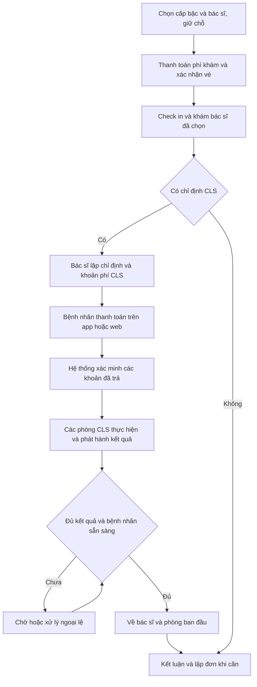

# Phạm vi nghiệp vụ dự án Smart Healthcare

**Ngày cập nhật:** 29/10/2026 16:30 giờ Việt Nam UTC+7  
**Phiên bản:** 2.1 đồng bộ chatbot và ranh giới module với Giải pháp kỹ thuật v2.1  
**Trạng thái:** Quy tắc đã chốt ở mức đặc tả; chưa xác nhận đã triển khai và kiểm chứng.

Tài liệu xác định hệ thống làm gì, phục vụ ai, các giới hạn nghiệp vụ và workflow khám ngoại trú. Nội dung chính được tách từ mục 1–5 của file Phạm vi và giải pháp kỹ thuật v2.0; bổ sung các quy tắc đổi/hủy lịch ở mục 15 và cấu hình nghiệp vụ ở mục 19 để phạm vi không bị thiếu. Bản bổ sung ngày 29/10/2026 làm rõ lựa chọn cấp bậc bác sĩ, thanh toán khám và CLS, lịch sử sức khỏe và tổng hợp chi phí theo từng lượt khám. Giải pháp triển khai và xử lý lỗi nằm trong tài liệu Giải pháp kỹ thuật và xử lý sự cố Smart Healthcare, phiên bản mới nhất là v2.1.

Mỗi bác sĩ có một phiên/ngày bắt đầu 06:30, tối đa 30 suất khám ban đầu, đóng nhận mới lúc 09:30 hoặc khi hết suất và không có giờ đóng ca cứng. Chatbot Hướng 2 chỉ phục vụ lịch, vé và trạng thái thanh toán khám; bác sĩ quyết định chuyên môn. Các chức năng nội bộ chỉ hoạt động từ mạng bệnh viện.

## 1 Nhật ký thay đổi phạm vi

**Đồng bộ kỹ thuật ngày 29/10/2026 16:30:** Chatbot bỏ LangGraph tự dựng và Model Adapter, chuyển sang FastAPI cùng LangChain `create_agent` và Ollama chạy model trong VPS. Ranh giới bounded context và cách giao tiếp giữa các module Backend được đặc tả ở mục 8.1 và 8.2 của Giải pháp kỹ thuật v2.1. Phạm vi chức năng của chatbot và của hệ thống không đổi.

**Chốt hoàn phí hủy lịch ngày 29/10/2026:** Từ chỉ quy định trả/khóa suất và theo dõi hoàn tiền riêng thành chính sách bệnh nhân chủ động hủy trước 05:00 ngày khám được hoàn toàn bộ phí khám ban đầu đã trả; từ đúng 05:00 không hoàn phí này. Xét theo thời điểm hủy có hiệu lực, không theo lúc tiền hoàn về.

**Bổ sung ngày 29/10/2026:** Từ mô tả lịch sử và thu phí còn chung thành yêu cầu lưu thông tin sức khỏe, chẩn đoán, kết quả và đơn thuốc theo từng lượt khám; lưu bảng giá, giá đã áp dụng và các giao dịch để tổng hợp số tiền. Làm rõ chọn cấp bậc/bác sĩ rồi thanh toán phí khám; sau khám lâm sàng, bác sĩ chỉ định CLS và bệnh nhân thanh toán trên app/web qua VNPT/MoMo.

Phiên bản 1.0 được lập lúc 26/10/2026 20:20 với phạm vi và phương án xử lý lỗi. Phiên bản 1.1 lúc 26/10/2026 20:40 chốt Hướng 2 và các nguyên tắc dùng primary, transaction và cache. Phiên bản 1.2 lúc 26/10/2026 21:15 bổ sung đối chiếu kiến trúc và hình từ bốn trang của tệp drawio mới nhất. Phiên bản 2.0 lúc 29/10/2026 00:32 chốt mô hình phiên khám, chính sách giữ chỗ qua mốc 09:30, hạn đổi lịch 05:00 và quy tắc khóa suất khi hủy muộn; bổ sung hạn check in riêng và làm rõ phần ngoài phạm vi. Phiên bản 2.1 lúc 29/10/2026 16:30 đồng bộ lựa chọn chatbot và ranh giới module với Giải pháp kỹ thuật v2.1. Nhật ký giữ lại các thay đổi trước để đọc được quá trình điều chỉnh.

| Nội dung | Từ định hướng trước | Thành định hướng hiện tại |
| --- | --- | --- |
| Chatbot | Báo cáo tuần 1 còn mô tả gợi ý chuyên khoa từ triệu chứng và trợ lý cho bác sĩ | Chatbot chỉ hỗ trợ tác vụ lịch khám, vé và trạng thái thanh toán khám của bệnh nhân theo quyền |
| Hai hướng chatbot | Dễ nhầm thành hai nhóm trợ lý | Hai cách phát triển cùng một chatbot bệnh nhân: API model nhà cung cấp hoặc model do nhóm fine tune |
| Tra thuốc | Có nhánh hỗ trợ bằng mô hình | Bác sĩ tìm tên thuốc, hoạt chất và thành phần bằng SQL hoặc Full Text Search |
| Nghiệp vụ thuốc | Có thể bị mở rộng sang nhà thuốc | Giữ danh mục tra cứu và đơn do bác sĩ lập; loại kho, bán thuốc, đặt mua theo đơn, thanh toán thuốc và cấp phát |
| Người dùng nhà thuốc | Có thể phát sinh vai trò dược sĩ | Không có dược sĩ trong hệ thống |
| Tài khoản CLS | Chưa chốt theo phòng | Mỗi phòng CLS dùng một tài khoản để cập nhật trạng thái bệnh nhân trong phạm vi phòng đó |
| Giới hạn tiếp nhận | Chưa có định mức cụ thể | Tối đa 30 lượt khám mới mỗi bác sĩ mỗi ngày và chặn đăng ký mới trong ngày từ 09:30 |
| Quay lại đọc kết quả | Quay lại bác sĩ phụ trách | Gắn rõ bác sĩ và phòng khám ban đầu; không tạo lượt khám mới hoặc trừ thêm suất |
| Lỗi khi đặt lịch | Có đề cập timeout và xử lý lặp | Lưu BookingAttempt và Operation để khôi phục đúng bước, phân biệt lỗi đã rollback với kết quả chưa xác định |
| Kiến trúc và tác vụ nền | Định hướng tách module và dùng sự kiện | Triển khai nền nghiệp vụ trong Modular Monolith; thêm worker có dữ liệu bền và outbox trước khi cân nhắc tách service |
| Lựa chọn chatbot trong phiên bản 1.1 | Hai cách phát triển còn được trình bày như phương án lựa chọn | Chọn Hướng 2: nhóm tự fine-tune model nền và vận hành API suy luận nội bộ |
| Hai Backend trong phiên bản 1.1 | Mô tả có thể chạy nhiều replica | Chốt BE1 và BE2 cùng dùng primary cho giữ chỗ, đổi, hủy và điều phối |
| Ranh giới transaction trong phiên bản 1.1 | Nguyên tắc transaction ngắn được nêu ở nhiều mục | Ghi rõ không giữ transaction khi chờ model hoặc người dùng; chỉ mở transaction cho thay đổi nghiệp vụ ngắn |
| Cache trong phiên bản 1.1 | Danh mục có thể dùng dữ liệu cho phép trễ | Chỉ phục vụ tra cứu theo chính sách; phải kiểm lại dữ liệu có thẩm quyền trước xác nhận nghiệp vụ |
| Sơ đồ trong phiên bản 1.2 | Báo cáo có ba sơ đồ giải thích riêng | Bổ sung cả bốn trang từ tệp drawio mới nhất, gồm kiến trúc, nhóm chức năng, workflow và tương tác; có hình phóng to và chú thích đối chiếu |
| Tác vụ nền trong phiên bản 1.2 | Hangfire là một lựa chọn thay bộ chạy job tự xây | Theo sơ đồ mới, dùng Hangfire với SQL Server để chạy job; Operation và Outbox tiếp tục giữ ý nghĩa nghiệp vụ, không chạy thêm một bộ lịch job tự xây song song |
| Hội thoại trong phiên bản 1.2 | LangGraph được để ở mức bổ sung khi cần | Theo sơ đồ mới, bố trí LangGraph cho trạng thái và luồng hội thoại nhiều bước; trạng thái đặt lịch chính thức vẫn do .NET và primary quyết định |
| Phiên khám trong phiên bản 2.0 | Hạn mức theo bác sĩ và ngày; còn nhắc nhiều ca và thời điểm đóng ca | Một phiên mỗi bác sĩ mỗi ngày D, bắt đầu 06:30, tối đa 30 suất, không có giờ đóng ca cứng; chỉ kết thúc khi mọi vé ở trạng thái cuối |
| Giữ chỗ trong phiên bản 2.0 | Cho hoàn tất sau cutoff còn là đề xuất; TTL cần chốt | Chọn HoldDuration mặc định 5 phút; giữ chỗ nhận trước 09:30 được hoàn tất đến ExpiresAt, không giới hạn ExpiresAt bằng CutoffAt; chấp nhận nguy cơ bỏ trống suất hết hạn sau cutoff |
| Đổi và hủy lịch trong phiên bản 2.0 | Chưa có mốc tự đổi hoặc quy tắc trả suất cụ thể | Khách tự đổi trước 05:00 ngày D; hủy hoặc đổi trước mốc này trả suất, hủy từ 05:00 khóa suất trong ngày D; kiểm nguyên tử và chống xử lý lặp |
| Check in và ngoài phạm vi trong phiên bản 2.0 | Thời hạn có mặt chưa được đặc tả riêng; nội trú mới được nêu chung | CheckInDeadline độc lập BookingCutoff, quá hạn chưa có mặt chuyển Vắng mặt; không quản lý nội trú hoặc công việc bác sĩ sau khi hoàn thành phiên trên hệ thống |
| Lịch sử khám và chi phí bổ sung ngày 29/10/2026 | Chưa tập hợp nội dung sức khỏe và tiền thanh toán theo từng lượt | Cùng một lượt khám lưu sức khỏe, chẩn đoán, chỉ định/kết quả, đơn thuốc và các khoản phí/giao dịch; tổng hợp chi phí và tiền đã trả trên app/web |
| Bảng giá và thu phí bổ sung ngày 29/10/2026 | Chưa làm rõ giá đã áp dụng và bước trả phí CLS | Lưu bảng giá cùng giá tại thời điểm thu; trả phí khám sau chọn cấp bậc/bác sĩ, trả phí CLS sau chỉ định; đổi bảng giá không đổi chi phí lịch sử |
| Hội thoại và máy chủ suy luận trong phiên bản 2.1 | LangGraph điều phối hội thoại nhiều bước; adapter và máy chủ suy luận Ollama hoặc Transformers | FastAPI cùng LangChain `create_agent` và Ollama trong VPS; không tự dựng graph LangGraph, không dùng adapter; trạng thái đặt lịch chính thức vẫn do .NET và primary quyết định |
| Ranh giới module trong phiên bản 2.1 | Chỉ liệt kê module và dữ liệu sở hữu | Ranh giới bounded context, lý do chia và bốn phương thức giao tiếp giữa module được đặc tả trong Giải pháp kỹ thuật v2.1; không thêm hoặc bớt chức năng |
| Thời điểm triển khai chatbot trong phiên bản 2.1 | Chưa nêu thứ tự so với các API nghiệp vụ | Chatbot triển khai sau khi API lịch, vé và thanh toán ổn định; khi chưa bật, bệnh nhân vẫn dùng đủ chức năng qua giao diện thủ công |

## 2 Phạm vi sản phẩm sau điều chỉnh

### 2.1 Chức năng đưa vào dự án

1. Bệnh nhân chọn cấp bậc bác sĩ mong muốn, tìm bác sĩ tương ứng và lịch khám, xem phí khám trước khi đặt và thanh toán; xem lịch, đổi hoặc hủy theo chính sách; tra vé và trạng thái thanh toán khám. Có giao diện thao tác trực tiếp và chatbot dùng chung API nghiệp vụ.
2. Tiếp tân đăng ký tại quầy, kiểm tra vé và check in. Đăng ký trực tuyến và tại quầy dùng cùng quỹ suất của bác sĩ và cùng cơ chế cấp vé.
3. Nhân viên ghi chỉ số ban đầu và điều phối hàng chờ theo phân công.
4. Bác sĩ lâm sàng gọi khám, ghi nhận thông tin, chỉ định CLS, xem kết quả đã phát hành, kết luận và lập đơn thuốc khi cần.
5. Tài khoản phòng CLS xác nhận bệnh nhân đến phòng, gọi lượt, bắt đầu, kết thúc thao tác trực tiếp và cập nhật kết quả theo quyền của phòng.
6. Hệ thống theo dõi nhiều vé dịch vụ trong cùng lượt khám, ngăn gọi một bệnh nhân vào hai điểm cùng lúc và kích hoạt quay lại bác sĩ ban đầu khi đủ điều kiện.
7. Quản trị cấu hình danh mục, bảng giá khám và dịch vụ CLS, lịch trực, phòng, sức chứa, quyền và giám sát ngoại lệ. Quyền quản trị kỹ thuật không mặc nhiên cho phép thay đổi kết quả chuyên môn.
8. Lưu lịch sử từng lượt khám: tình trạng sức khỏe, sinh hiệu, nội dung khám, chẩn đoán, chỉ định/kết quả CLS, kết luận và đơn thuốc của bác sĩ. Bệnh nhân và người đại diện hợp lệ xem nội dung đã phát hành thuộc quyền.
9. Bệnh nhân thanh toán phí khám ban đầu và phí CLS được bác sĩ chỉ định trên app/web qua VNPT/MoMo theo phương thức đã cấu hình. Lưu các khoản phí và giao dịch để tổng hợp chi phí, tiền đã trả, tiền đã hoàn và tiền còn phải trả của từng lượt khám.

### 2.2 Chức năng loại khỏi phạm vi

Không có quản lý nhập xuất tồn thuốc, lô và hạn dùng, bán thuốc theo đơn, đặt thuốc theo đơn, giao thuốc, thu tiền thuốc, cấp phát thuốc hoặc tài khoản dược sĩ. Bảng thuốc là danh mục để tra cứu và lập đơn; không có số tồn hay trạng thái còn hàng. Thanh toán trong dự án gồm phí khám ban đầu và các dịch vụ CLS do bác sĩ chỉ định trong lượt khám, không phải thanh toán thuốc.

Chatbot không tư vấn chẩn đoán, chọn thuốc, kê đơn, đề xuất CLS hoặc quyết định thứ tự khám. Những nhánh gợi ý chuyên môn bằng AI và dự đoán bỏ hẹn trong sơ đồ cũ được đưa ra khỏi phạm vi triển khai hiện tại. Bác sĩ vẫn quyết định chỉ định và đơn thuốc bằng giao diện nghiệp vụ.

Nội trú, cấp cứu, bảo hiểm, đa cơ sở và tích hợp tự động thiết bị xét nghiệm hoặc PACS không được bổ sung qua lần điều chỉnh này. Ngoại lệ chuyên môn cần được nhân viên xử lý theo quy trình riêng, không đi vòng giới hạn đăng ký bằng chatbot.

Không quản lý bệnh nhân nội trú. Không quản lý công việc của bác sĩ sau khi đã hoàn thành phiên khám trên hệ thống, ví dụ khám cho bệnh nhân nhập viện hoặc nội trú.

### 2.3 Quy tắc truy cập tiếp tục áp dụng

Kênh bệnh nhân trên app và web được truy cập công khai; dữ liệu cá nhân và thao tác thay đổi yêu cầu xác thực và kiểm quyền tại Backend. Mọi web, API, thiết bị check in và chức năng nhân viên, bác sĩ, quản trị chỉ hoạt động từ LAN hoặc Wi Fi bệnh viện và có đúng quyền. Ràng buộc này áp dụng cả SignalR và đường truy cập tệp nội bộ. Tài khoản phòng không có quyền đi vòng qua API công khai.

## 3 Nhân sự thực tế và tài khoản trên hệ thống

### 3.1 Quy mô nhân sự theo hai ảnh tham chiếu

Các số dưới đây là khoảng ước tính mỗi ca trong ảnh, dùng để lập bối cảnh và kịch bản tải, không phải kết quả đo công suất thực tế.

| Khu vực và nhóm nhân sự | Số người mỗi ca | Cách thể hiện trên hệ thống |
| --- | --- | --- |
| Tiếp đón và hỗ trợ gồm lễ tân hoặc CSKH | 4 đến 6 | Tài khoản tiếp tân theo phân công; không đồng nhất với tài khoản phòng CLS |
| Phòng khám lâm sàng gồm bác sĩ chuyên khoa | 40 đến 50 | Danh tính bác sĩ riêng, lịch làm việc và hạn mức theo từng bác sĩ |
| Điều dưỡng phòng khám | 25 đến 35 | Quyền tiếp nhận, sinh hiệu và hỗ trợ trong phạm vi được giao |
| Chẩn đoán hình ảnh gồm bác sĩ điện quang hoặc nội soi | 10 đến 15 | Thao tác tại tài khoản phòng CLS theo phạm vi đã cấp |
| Chẩn đoán hình ảnh gồm KTV hoặc điều dưỡng | 15 đến 20 | Cùng mô hình tài khoản phòng; quyền thao tác phải được giới hạn |
| Xét nghiệm gồm KTV hoặc nhân sự xét nghiệm | 10 đến 15 | Tài khoản phòng xét nghiệm tương ứng |
| Tổng phạm vi đầy đủ | 104 đến 141 | Không suy ra có từng ấy tài khoản hoặc phiên đồng thời |

Ảnh thứ hai có tổng 75 đến 100 người vì chỉ cộng bác sĩ lâm sàng, bác sĩ và KTV chẩn đoán hình ảnh, nhân sự xét nghiệm. Bảng này không cộng tiếp đón và điều dưỡng phòng khám. Hai tổng phản ánh hai phạm vi thống kê; không cộng chúng với nhau.

### 3.2 Một tài khoản cho mỗi phòng CLS

Mỗi phòng CLS có một RoomAccount liên kết RoomId và danh sách dịch vụ được phép. Ví dụ phòng X quang 01 và phòng X quang 02 có hai tài khoản phòng khác nhau dù cùng chuyên môn. Số tài khoản CLS bằng số phòng CLS được cấu hình, không bằng số nhân sự trực và cũng không mặc định chỉ có một tài khoản cho toàn bộ một khoa.

Một tài khoản phòng có thể được dùng trên thiết bị đã đăng ký theo chính sách phiên. Nếu nhiều thiết bị cùng mở phòng đó, Backend vẫn kiểm idempotency và phiên bản; không dựa vào việc dùng chung tài khoản để cho rằng thao tác sẽ diễn ra tuần tự. Nếu giới hạn một phiên hoạt động mỗi phòng để đơn giản hóa MVP, cơ chế chống xung đột ở DB vẫn cần giữ.

Nhật ký tối thiểu ghi RoomAccountId, RoomId, ca trực, DeviceId, SessionId, người phụ trách ca được khai báo, OperationId, thời gian và thay đổi trước sau. Tài khoản phòng chỉ cập nhật vé thuộc phòng, không đổi hạn mức bác sĩ, không xác nhận thanh toán và không tự chuyển bệnh nhân sang bác sĩ khác.

**Giới hạn truy vết:** Với một thông tin đăng nhập dùng chung, log xác định được tài khoản phòng và thiết bị; không chứng minh chắc chắn cá nhân nào đã thao tác. Danh sách người phụ trách ca giúp quản lý trách nhiệm nhưng không thay thế xác thực cá nhân. Những quyền duyệt kết quả chuyên môn phải được cơ sở phân công rõ; không mặc định mọi người biết mật khẩu phòng đều có quyền duyệt. Nếu cần định danh người duyệt, bổ sung bước xác nhận bằng danh tính cá nhân mà vẫn giữ màn hình vận hành của phòng.

### 3.3 Công suất phòng không phụ thuộc số tài khoản

RoomCapacity là số vị trí hoặc thiết bị có thể phục vụ độc lập tại cùng thời điểm. Một phòng có một tài khoản và ba bàn lấy mẫu có thể phục vụ ba bệnh nhân nếu nhân lực và quy trình cho phép; một máy chụp đơn lẻ không được cấu hình ba vị trí chỉ vì có ba nhân viên.

Cần tách RoomAccount, nhân sự trực, ServiceStation và năng lực thiết bị thành các khái niệm riêng. Lịch trực xác định tài nguyên hoạt động trong ngày; việc đóng một vị trí phải cập nhật sức chứa và không làm mất các lượt đang phục vụ.

## 4 Định mức 30 lượt và mốc 09 giờ 30

### 4.1 Đơn vị tính hạn mức

Mỗi bác sĩ lâm sàng có **một phiên khám mỗi ngày phục vụ D, bắt đầu từ 06:30 giờ Việt Nam**, với tối đa **30 suất khám ban đầu**, tính chung tất cả kênh online, chatbot, app và tại quầy. Khóa phiên và hạn mức là DoctorId cùng ServiceDate. Nếu bác sĩ đổi phòng thì vẫn thuộc phiên và dùng chung hạn mức ngày, không phát sinh quỹ 30 suất mới.

Phiên khám **không có giờ đóng ca cứng**. Nếu đến buổi chiều chưa khám xong thì tiếp tục khám, mọi chức năng hệ thống vẫn hoạt động. Phiên kết thúc khi mọi vé của phiên ở trạng thái cuối: **Đã khám xong** (bao gồm đã đọc kết quả CLS), **Vắng mặt** hoặc **Đã hủy**. Không coi kết thúc thao tác CLS hoặc phát hành kết quả là đã hoàn thành toàn bộ lượt khám khi bác sĩ chưa đọc kết quả và kết luận.

Một EncounterId đại diện cho một lượt khám. Vé khám đầu, các vé CLS và vé quay lại đều liên kết lượt đó. Bệnh nhân quay lại đọc kết quả không chiếm suất thứ 31, không thanh toán lại phí khám đầu chỉ vì quay lại và không phải đặt lại lịch. Một lần tái khám độc lập ở ngày khác là lượt khám mới theo chính sách tương ứng.

Với 40 đến 50 bác sĩ thực sự mở lịch đủ 30 suất, trần lý thuyết là 1.200 đến 1.500 lượt khám mới mỗi ngày. Đây là trần đăng ký, không bảo đảm toàn bộ số đó sẽ đến hoặc hoàn thành trong ngày. Thời gian khám, tỷ lệ làm CLS, số lượt quay lại và năng lực các phòng quyết định tải thực tế. Không lấy 30 nhân toàn bộ 104 đến 141 nhân sự.

### 4.2 Điều kiện nhận đăng ký mới

Đối với ngày phục vụ D, chỉ tạo giữ chỗ mới khi lịch bác sĩ đang mở, còn suất và thời điểm xét nhận tại DB nhỏ hơn 09:30 của ngày D theo giờ Việt Nam. Hệ thống đóng khi **đủ 30 suất hoặc đến mốc 09:30**, điều kiện nào đến trước. Từ đúng 09:30:00 ngày D được coi là đã đóng nhận mới. Đây là mốc BookingCutoff của ngày phục vụ D.

Việc đặt cho ngày mai xét mốc đóng của ngày mai, vì vậy 10 giờ hôm nay vẫn có thể đặt ngày mai nếu ngày mai còn suất và nằm trong khoảng ngày được mở. Không dùng điều kiện giờ hiện tại lớn hơn 09:30 để vô tình chặn mọi ngày tương lai. DB lưu thời điểm UTC; chính sách được cấu hình theo Asia/Ho_Chi_Minh và chuyển thành CutoffAtUtc cho từng ngày.

**Chính sách đã chọn cho giữ chỗ trước mốc đóng:** Giữ chỗ được chấp nhận trước 09:30 được thanh toán và xác nhận đến hết thời hạn giữ chỗ, với HoldDuration mặc định **5 phút**. Ví dụ giữ lúc 09:28 thì ExpiresAt là 09:33 và có thể hoàn tất lúc 09:32. Sau 09:30 không tạo giữ chỗ mới hoặc gia hạn để lách mốc. **Không giới hạn ExpiresAt bằng CutoffAt.** Nếu muốn cấm cả việc xác nhận sau 09:30, phải đổi chính sách và giới hạn ExpiresAt bằng CutoffAt; đây là phương án khác, không áp dụng đồng thời với chính sách đã chọn.

Lý do chọn là ưu tiên trải nghiệm người dùng: khách đã được hệ thống chấp nhận giữ chỗ trước 09:30 không bị hết hạn giữa chừng khi đang thanh toán. Danh sách vé ngày D được chốt khi giữ chỗ cuối cùng được xác nhận hoặc hết hạn, tối đa 5 phút sau 09:30 với HoldDuration mặc định. Điều này không ảnh hưởng đến việc khám vì phiên không có giờ đóng ca cứng. Hạn chế đã chấp nhận là một suất giữ trước 09:30 nhưng không được thanh toán có thể bị bỏ trống, vì sau 09:30 không còn nhận đặt mới.

Mốc 09:30 **chỉ đóng tiếp nhận mới**, không kết thúc khám, không hủy vé đã có và không chặn đọc kết quả sau CLS. Sau mốc này, check in, gọi số, khám, chỉ định CLS, trả và đọc kết quả CLS, xem vé và xem lịch sử vẫn hoạt động bình thường theo điều kiện nghiệp vụ tương ứng.

Mỗi phiên có **CheckInDeadline** là hạn có mặt được cấu hình riêng, không trùng với BookingCutoff. Vé quá hạn check in mà bệnh nhân chưa có mặt được chuyển sang **Vắng mặt**, để phiên có thể kết thúc. Mốc 09:30 không tự đánh dấu Vắng mặt; hạn check in cũng không kết thúc các lượt đang khám hoặc đang chờ bác sĩ đọc kết quả CLS.

### 4.3 Cách tính suất đang bị chiếm

Đề xuất lưu HeldCount cho giữ chỗ đang hiệu lực, AdmittedCount cho những lượt đã xác nhận chưa được trả suất và LockedCancelledCount cho số suất bị khóa do hủy từ 05:00 ngày D. Các nhóm không đếm trùng. Quy tắc bất biến là các bộ đếm không âm và **HeldCount + AdmittedCount + LockedCancelledCount không vượt Capacity**, mặc định Capacity bằng 30.

**Số suất còn trống của ngày D = 30 − số vé đang hiệu lực − số giữ chỗ đang hiệu lực − số suất bị khóa do hủy sau 05:00.** Trong công thức hạn mức, vé đang hiệu lực được hiểu là lượt đã xác nhận chưa được trả suất; vé đã khám xong hoặc Vắng mặt vẫn được tính vào AdmittedCount để không tiếp nhận vượt 30 lượt. Vé hủy từ đúng 05:00 được loại khỏi AdmittedCount nhưng chuyển suất sang LockedCancelledCount; không vừa trừ vé hủy vừa đếm suất khóa cho cùng một lượt.

| Sự kiện | Thay đổi bộ đếm | Quy tắc |
| --- | --- | --- |
| Giữ chỗ mới thành công | HeldCount tăng 1 | Chỉ khi còn chỗ và chưa qua mốc nhận mới |
| Xác nhận từ giữ chỗ hợp lệ | HeldCount giảm 1 và AdmittedCount tăng 1 | Tổng suất bị chiếm giữ nguyên |
| Hết hạn hoặc hủy giữ chỗ | HeldCount giảm 1 đúng một lần | Worker và callback phải tranh cùng chuyển trạng thái nguyên tử |
| Hủy hoặc đổi lịch thành công trước 05:00 ngày D | AdmittedCount của ngày D giảm 1 đúng một lần | Trả suất cũ; chỉ nhận đặt mới nếu lịch mở, còn suất và chưa đến BookingCutoff |
| Hủy lịch từ 05:00 ngày D khi trạng thái còn cho phép | AdmittedCount giảm 1, LockedCancelledCount tăng 1 trong cùng transaction | Không trả suất để đặt mới trong ngày D; callback hoặc request lặp không khóa thêm suất |
| Khám xong hoặc quay lại đọc kết quả | Không giảm AdmittedCount | Hoàn thành không mở thêm suất để vượt 30 người đã tiếp nhận |
| Quá CheckInDeadline mà bệnh nhân chưa có mặt | Chuyển vé sang Vắng mặt; không giảm AdmittedCount | Cho phép kết thúc phiên khi mọi vé ở trạng thái cuối; không tự mở suất thay thế |

Nếu giữ chỗ đã hết hạn nhưng worker chưa dọn, chưa được dùng giữ chỗ đó để xác nhận. Để trả lại suất, chạy thao tác hết hạn có điều kiện trong transaction; không chỉ lấy 30 trừ số liệu trên cache. Có thể dọn các giữ chỗ hết hạn của đúng DoctorDay trước lần thử nhận mới để tránh báo hết suất giả.

Số vé hiển thị không phải bộ đếm hạn mức. Nếu có hủy và đặt lại, tổng số vé từng phát hành có thể lớn hơn 30 dù số lượt đang chiếm suất hợp lệ không vượt trần. Số vé không được tái sử dụng cho bệnh nhân khác; các khoảng trống do rollback hoặc hủy không phải lỗi nghiệp vụ.

## 5 Workflow khám sau khi thu hẹp phạm vi

### 5.1 Đặt lịch và khám ban đầu

Bệnh nhân chọn cấp bậc bác sĩ mong muốn, chọn bác sĩ tương ứng và ngày khám bằng giao diện hoặc chatbot. Hệ thống hiển thị mức phí khám áp dụng để bệnh nhân xác nhận trước khi thanh toán qua VNPT/MoMo trên app/web. Backend kiểm danh tính, hồ sơ được đại diện, lịch hiện hành và giá trong DB; ghi nháp, giữ chỗ, tạo yêu cầu thanh toán và xác nhận theo các bước đã lưu. Chỉ xác nhận lịch và cấp vé hợp lệ sau khi thanh toán được xác minh thành công và giữ chỗ vẫn đáp ứng quy tắc. Lưu lựa chọn bác sĩ/cấp bậc và mức phí áp dụng, không lấy số tiền do người dùng tự nhập làm căn cứ thu. Đăng ký tại quầy đi vào cùng luồng cấp suất. Việc nhân viên thu tiền trực tiếp cần được cấu hình thành phương thức riêng; tài khoản phòng CLS không được tự đánh dấu đã thanh toán.

Sau khi vé hợp lệ, tiếp tân check in tại bệnh viện, nhân viên ghi sinh hiệu và bác sĩ được chọn gọi khám. Thanh toán, check in và đủ điều kiện gọi là các thông tin khác nhau. Chưa check in không được coi là đã có mặt dù vé đã thanh toán.

### 5.2 Cận lâm sàng và quay lại bác sĩ ban đầu

Sau khi khám lâm sàng, bác sĩ trực tiếp lập chỉ định các dịch vụ CLS cần thực hiện, gồm xét nghiệm, siêu âm, nội soi và chụp X-quang theo danh mục bệnh viện. Hệ thống tạo các ServiceOrderItem, khoản phí và vé dịch vụ, đồng thời tạo một vé quay lại cho đợt chỉ định đang hoạt động. Bệnh nhân mở app/web xem các dịch vụ được chỉ định, đơn giá và tổng phải trả, rồi bấm thanh toán qua VNPT/MoMo. Hệ thống xác minh giao dịch và ghi nhận các khoản đã trả trước khi cho phép bắt đầu dịch vụ tương ứng. Vé đã tạo có thể còn chờ thanh toán; có mã vé không đồng nghĩa đã đủ điều kiện thực hiện CLS. Gửi lại yêu cầu hoặc thông báo thanh toán không tạo thêm khoản thu hay vé trùng. Lưu OriginalDoctorId, OriginalRoomId và EncounterId từ lượt khám đầu. Kết quả và vé quay lại gắn với các mã này, không dựa vào tên phòng do người dùng nhập lại.

Tại từng phòng CLS, tài khoản phòng xác nhận đã đến, nhận lượt, bắt đầu và kết thúc thao tác trực tiếp. Lấy mẫu xong có thể giải phóng bệnh nhân sang điểm khác trong khi mẫu đang được xử lý. ServiceFinished không đồng nghĩa ResultPublished.

Chỉ kích hoạt vé quay lại khi các kết quả bắt buộc của đợt chỉ định đã được phát hành hợp lệ, hoặc có quyết định hủy hay miễn dịch vụ được ghi nhận bởi người có quyền; bệnh nhân cũng phải đang sẵn sàng. Nhân viên không được tích hoàn tất toàn lượt chỉ để thoát trạng thái chờ kết quả.

Bệnh nhân quay lại phòng ban đầu để chính bác sĩ đó đọc kết quả và kết luận. Nếu bác sĩ hoặc phòng không còn hoạt động, tạo ngoại lệ chờ điều phối; người có quyền ghi nhận chuyển bác sĩ hoặc phòng cùng lý do, thông báo và lịch sử. Không âm thầm gán kết quả cho bác sĩ bất kỳ hoặc bắt bệnh nhân đặt lại từ đầu.

### 5.3 Trộn lượt khám mới và lượt quay lại

Hai loại vé cùng được phục vụ bởi bác sĩ ban đầu nhưng không dùng chung phép tính suất khám mới. Có thể thí điểm quy tắc gọi hai lượt khám đầu rồi một lượt quay lại nếu cả hai nhóm đều đủ điều kiện; khi một nhóm trống thì phục vụ nhóm còn lại. Đây là đề xuất cấu hình, cần đo thời gian chờ để điều chỉnh. Giữ thứ tự trong từng nhóm và có ngưỡng chờ để tránh bỏ đói một nhóm.

### 5.4 Lịch sử sức khỏe theo từng lượt khám

Mỗi lượt khám có một EncounterId, liên kết khám ban đầu, các đợt CLS và quay lại bác sĩ đọc kết quả. Đi nhiều phòng hoặc thanh toán nhiều lần trong cùng hành trình không tạo nhiều lượt khám độc lập. Một lần khám mới ở ngày khác tạo lượt mới, có thể tham chiếu lịch sử được phép xem.

| Nhóm thông tin | Nội dung lưu theo từng lượt khám |
| --- | --- |
| Thông tin lượt khám | Bệnh nhân, lịch hẹn, ngày giờ, bác sĩ và phòng ban đầu, chuyên khoa và cấp bậc bác sĩ tại thời điểm khám |
| Tình trạng sức khỏe | Lý do khám, triệu chứng, tiền sử liên quan được ghi nhận, sinh hiệu và nội dung khám lâm sàng |
| Chẩn đoán và kết luận | Chẩn đoán ban đầu, chẩn đoán/kết luận sau CLS, hướng xử trí và hướng dẫn theo dõi do bác sĩ ghi |
| Chỉ định và kết quả CLS | Từng dịch vụ được chỉ định, đợt chỉ định, phòng/thiết bị thực hiện khi có, trạng thái, kết quả và tệp đã phát hành |
| Đơn thuốc | Bác sĩ kê, ngày kê, danh sách thuốc, hàm lượng, liều dùng, đường dùng, tần suất, số ngày, số lượng và hướng dẫn sử dụng |
| Chi phí và thanh toán | Các khoản phí với giá đã áp dụng, giao dịch thu/hoàn và tổng hợp chi phí theo mục 5.5 |

Bệnh nhân hoặc người đại diện hợp lệ xem lịch sử và nội dung đã phát hành thuộc quyền trên app/web. Bác sĩ và nhân viên xem, ghi hoặc duyệt theo phân công và quyền được cấp; quyền admin kỹ thuật không mặc nhiên cho phép sửa nội dung chuyên môn. Sửa thông tin đã phát hành phải giữ phiên bản trước, người sửa, thời điểm và lý do. Lưu đơn thuốc không mở rộng sang bán thuốc, thu tiền thuốc hoặc quản lý nhà thuốc.

### 5.5 Bảng giá và thanh toán theo lượt khám

**Bảng giá danh mục:** DB lưu phí khám theo bác sĩ/cấp bậc theo chính sách bệnh viện và giá từng dịch vụ CLS, kèm loại tiền, thời gian hiệu lực và trạng thái áp dụng. Mỗi dịch vụ được liên kết với các phòng/thiết bị có thể thực hiện. Chỉ áp dụng giá riêng theo phòng/thiết bị nếu bệnh viện có chính sách giá khác nhau; không mặc định mọi dịch vụ trong một phòng có cùng giá.

**Giá đã áp dụng:** Khi tạo khoản thu, lưu loại phí hoặc dịch vụ, đơn giá áp dụng, số lượng, thành tiền và thông tin bảng giá làm căn cứ. Thay đổi bảng giá về sau không tính lại khoản đã chốt hoặc đã thanh toán của lượt khám cũ. Ví dụ phí khám 150.000 đồng và siêu âm 200.000 đồng tạo tổng chi phí 350.000 đồng; nếu giá siêu âm về sau tăng lên 250.000 đồng thì lượt khám cũ vẫn giữ 350.000 đồng.

**Nhiều lần thanh toán trong một lượt khám:** Lần đầu trả phí khám khi đặt lịch; sau đó trả phí các dịch vụ CLS được bác sĩ chỉ định. Một lần thanh toán có thể trả cho nhiều khoản phí, nhưng phải xác định rõ những khoản nào đã được trả. Khoản thu lúc đặt lịch phải được liên kết đúng lượt khám khi lượt khám hình thành, không bị mất vì phát sinh trước khi bệnh nhân đến viện. Dịch vụ chưa được thanh toán không tự đủ điều kiện thực hiện vì một dịch vụ khác đã trả tiền.

DB lưu từng giao dịch với mã tham chiếu, nhà cung cấp, mã giao dịch phía nhà cung cấp, số tiền, loại tiền, thời điểm, trạng thái và các khoản phí được thanh toán. Chỉ ghi nhận đã trả sau khi hệ thống xác minh đúng giao dịch, khoản tiền và người nhận; thông báo trên màn hình bệnh nhân chưa đủ để xác nhận. Khi trạng thái chưa rõ, kiểm tra giao dịch cũ trước khi yêu cầu trả lại. Hoàn tiền liên kết khoản thu gốc và được theo dõi riêng, không xóa lịch sử đã thu tiền.

| Chỉ tiêu hiển thị trong lịch sử lượt khám | Cách xác định |
| --- | --- |
| Tổng chi phí phải trả | Tổng thành tiền các khoản phí còn hiệu lực sau điều chỉnh hợp lệ |
| Tổng đã thanh toán | Tổng các giao dịch thu đã xác minh thành công, không tính giao dịch đang chờ/thất bại hoặc cộng lặp thông báo |
| Tổng đã hoàn tiền | Tổng các giao dịch hoàn tiền đã xác minh thành công, không tính yêu cầu hoàn còn chờ |
| Số tiền thực thu | Tổng đã thanh toán trừ tổng đã hoàn tiền |
| Còn phải trả | Phần nghĩa vụ thanh toán chưa được đáp ứng sau phân bổ tiền và điều chỉnh hợp lệ; theo dõi tiền thu thừa/chờ hoàn riêng |

App/web hiển thị các chỉ tiêu này cùng lịch sử sức khỏe của lượt khám. Tổng tiền có thể tính từ các khoản phí và giao dịch, không bắt buộc lưu thêm một trường tổng trên hồ sơ lượt khám. **DB vẫn lưu đơn giá đã áp dụng, thành tiền từng khoản và số tiền từng giao dịch**; không chỉ lưu bảng giá hiện hành hoặc để số tiền chỉ tồn tại trên vé/phiếu thanh toán. Vé hàng đợi và phiếu xác nhận thanh toán phục vụ các mục đích riêng. Hủy dịch vụ và hoàn tiền phải được theo dõi cùng việc điều chỉnh khoản phí để không thu lại khoản đã được hủy.

## 6 Chính sách đổi và hủy lịch

### 6.1 Đổi lịch

Bệnh nhân được tự đổi lịch trước 05:00 ngày phục vụ D theo giờ Việt Nam. Từ đúng 05:00, từ chối tự đổi kể cả khi màn hình xác nhận đã mở từ trước; căn cứ là thời điểm thao tác có hiệu lực ở hệ thống. Ngày đích phải đang mở, còn suất và chưa đến BookingCutoff của ngày đích. Chatbot và giao diện trực tiếp dùng cùng chính sách, không có quyền vượt mốc.

Hiển thị lịch cũ và phương án mới để xác nhận. Chỉ trả suất cũ khi đổi thành công; nếu không đổi được thì giữ nguyên lịch cũ. Người đã bắt đầu khám không được tự đổi sang lượt khác để giải phóng suất đã sử dụng. Tài liệu gốc có đề cập khung giờ như trường hợp mở rộng; điều này không tạo thêm phiên hoặc thêm quỹ 30 suất cho cùng bác sĩ/ngày.

### 6.2 Hủy lịch

Hủy cần đúng quyền, trạng thái còn cho phép và xác nhận cụ thể. Chính sách dưới đây áp dụng khi bệnh nhân chủ động hủy lịch khám và chỉ xét phí khám ban đầu đã thanh toán. Bệnh nhân có thể hủy sau hạn tự đổi 05:00; suất và quyền hoàn phí được xử lý theo thời điểm hủy có hiệu lực trên hệ thống, tính theo giờ Việt Nam của ngày khám D:

- **Trước 05:00 ngày D:** vé chuyển Đã hủy, trả suất cũ và bệnh nhân được hoàn toàn bộ phí khám ban đầu đã thanh toán. Chỉ nhận người mới nếu lịch mở, còn suất và chưa đến BookingCutoff.
- **Từ đúng 05:00 ngày D:** vé chuyển Đã hủy, khóa suất trong ngày D và không hoàn phí khám ban đầu. Không cho đặt mới thay thế và không dùng hủy/đặt lại để lách hạn tự đổi.

Hủy và phát sinh yêu cầu hoàn chỉ tác động một lần. Với trường hợp đủ điều kiện, ghi nhận thời điểm hủy, số tiền được hoàn và trạng thái chờ hoàn ngay khi hủy có hiệu lực; thời điểm tiền thực tế về tài khoản được theo dõi riêng. Hủy thành công lúc 04:59 vẫn được hoàn dù xử lý hoàn sau 05:00; hủy có hiệu lực lúc 05:00:00 không được hoàn theo chính sách này. Nếu chưa thu tiền thì không phát sinh khoản hoàn.

Lịch đã hủy không tự chuyển thành đã hoàn tiền. Với hủy muộn, lịch sử vẫn ghi nhận khoản phí khám không được hoàn và giao dịch đã thu; không xóa khoản tiền này hoặc tạo yêu cầu thu lại chỉ vì vé đã hủy. Trước khi bệnh nhân xác nhận hủy, app/web hiển thị rõ số tiền được hoàn hoặc không được hoàn.

Tài khoản phòng CLS không hủy lịch khám gốc hoặc hoàn tiền; trường hợp bệnh nhân đang phục vụ cần người có thẩm quyền xử lý. Quy tắc không hoàn sau 05:00 không tự áp dụng cho bệnh viện/bác sĩ hủy lịch, lỗi hệ thống, giao dịch thu trùng hoặc phí dịch vụ CLS; các trường hợp này có chính sách xử lý riêng cần hoàn thiện.

## 7 Chính sách đã chốt và thông tin còn cần xác định

| Nội dung | Quy định và trạng thái |
| --- | --- |
| Phiên bác sĩ | Một phiên/ngày D, bắt đầu 06:30, không có giờ đóng ca cứng |
| Hạn mức | Tối đa 30 suất ban đầu, dùng chung mọi kênh và không tăng khi đổi phòng |
| BookingCutoff | 09:30 ngày D; đóng sớm hơn nếu hết suất |
| HoldDuration | Mặc định 5 phút; giữ trước cutoff được hoàn tất đến ExpiresAt, kể cả qua 09:30 |
| RescheduleCutoff | 05:00 ngày D; từ mốc này không tự đổi và hủy không mở lại suất |
| Hoàn phí khi bệnh nhân chủ động hủy | Trước 05:00 ngày D: trả suất và hoàn toàn bộ phí khám ban đầu đã trả; từ đúng 05:00: khóa suất và không hoàn phí này. Xét thời điểm hủy có hiệu lực; tiền hoàn có thể về sau |
| CheckInDeadline | Giá trị cần cấu hình riêng; quá hạn chưa có mặt thì Vắng mặt, không trả suất |
| Quay lại đọc kết quả | Cùng lượt khám và bác sĩ/phòng ban đầu; không thêm suất, không thu lại phí khám đầu vì quay lại |
| Trộn hàng chờ | Đề xuất thử nghiệm 2 lượt mới/1 lượt quay lại; cần đo và có ngưỡng tránh bỏ đói |
| Chọn bác sĩ và phí khám | Chọn cấp bậc, bác sĩ và ngày; xem phí áp dụng, thanh toán rồi xác nhận lịch/vé theo quy tắc giữ chỗ |
| Thu phí CLS | Đã chốt thu sau khi bác sĩ chỉ định; bệnh nhân xem khoản phí và thanh toán trên app/web qua VNPT/MoMo; chỉ bắt đầu dịch vụ sau khi xác minh khoản đã trả |
| Chatbot | Hướng 2; FastAPI cùng LangChain và Ollama trong VPS; chỉ phục vụ lịch, vé và trạng thái thanh toán khám; model nền cụ thể và thời gian phản hồi cần đo trước khi chốt |
| Lịch sử lượt khám | Lưu sức khỏe, chẩn đoán, kết quả, đơn thuốc và các khoản phí/giao dịch trong cùng Encounter; xem theo quyền và trạng thái phát hành |
| Bảng giá và chi phí lịch sử | Lưu giá danh mục và giá đã áp dụng; đổi giá không thay chi phí cũ; tổng hợp tổng chi phí, tiền đã trả, tiền hoàn và tiền còn phải trả |
| Chi tiết vận hành còn mở | Số phòng/vị trí thực hoạt động, trạng thái được hủy, quyền duyệt kết quả và thu tại quầy; mức giá cụ thể, thời hạn trả phí CLS, sản phẩm VNPT/MoMo và tài khoản merchant, xử lý chênh lệch phí khi đổi lịch, hủy/hoàn phí CLS, bệnh viện/bác sĩ hủy lịch và lỗi hệ thống. Hoàn phí khám do bệnh nhân chủ động hủy đã chốt ở mục 6.2 |

Mốc thời gian nghiệp vụ dùng giờ Việt Nam. Không quản lý nội trú hoặc công việc của bác sĩ sau khi hoàn thành phiên trên hệ thống. Các giá trị chưa có dữ liệu thực tế phải được xác định trước khi triển khai, không suy từ tổng nhân sự.
